# Session: bob-cli-qq.1

[Agent Hoods](../README.md) / [bbugyi200](../users/bbugyi200/README.md) / [apollo](../users/bbugyi200/machines/apollo/README.md) / [bob-cli-qq](../users/bbugyi200/machines/apollo/hoods/bob-cli-qq/README.md) / bob-cli-qq.1

Owner: `bbugyi200.apollo` · Hood: `bob-cli-qq` · Members: 13 · Bead: [bob-cli-qq.1](https://github.com/bobs-org/bob-cli--beads/blob/main/pages/bob-cli-qq/bob-cli-qq.1.md)

## Lineage

```mermaid
flowchart TD
  n0["bob-cli-qq.1--4 [completed]"]
  n1["bob-cli-qq.1--mon-1 [failed]"]
  n0 --> n1
  n2["bob-cli-qq.1--2 [completed]"]
  n0 --> n2
  n3["bob-cli-qq.1--mon-2 [failed]"]
  n0 --> n3
  n4["bob-cli-qq.1--3 [completed]"]
  n0 --> n4
  n5["bob-cli-qq.1--5 [completed]"]
  n0 --> n5
  n6["bob-cli-qq.1--mon [failed]"]
  n0 --> n6
  n7["bob-cli-qq.1--1 [completed]"]
  n0 --> n7
  n8["bob-cli-qq.1--plan [completed]"]
  n0 --> n8
  n9["bob-cli-qq.1--mon-3 [completed]"]
  n0 --> n9
  n10["bob-cli-qq.1--6 [completed]"]
  n0 --> n10
  n11["bob-cli-qq.1--gate [completed]"]
  n0 --> n11
  n12["bob-cli-qq.1--mon-0 [failed]"]
  n0 --> n12
```

The diagram is an optional enhancement; the ordered table below contains the same lineage in accessible text.

| Role | Agent | State | Model / provider | Timing | Commits | Prompt | Chat |
|---|---|---|---|---|---:|---|---|
| 4 | bob-cli-qq.1--4 | completed | gpt-6-luna / codex | 2026-11-26T23:59:53.343484+00:00 → 2026-11-27T00:06:41.248095+00:00 | 0 | [Prompt](../agents/bbugyi200.apollo.bob-cli-qq.1--4/prompt.md) | [Chat](../agents/bbugyi200.apollo.bob-cli-qq.1--4/chat.md) |
| mon-1 | bob-cli-qq.1--mon-1 | failed | gpt-6-luna / codex | 2026-11-26T23:53:26.579195+00:00 → 2026-11-26T23:59:53.457696+00:00 | 0 | — | [Chat](../agents/bbugyi200.apollo.bob-cli-qq.1--mon-1/chat.md) |
| 2 | bob-cli-qq.1--2 | completed | gpt-6-luna / codex | 2026-11-26T23:45:35.135503+00:00 → 2026-11-26T23:51:18.815213+00:00 | 0 | [Prompt](../agents/bbugyi200.apollo.bob-cli-qq.1--2/prompt.md) | [Chat](../agents/bbugyi200.apollo.bob-cli-qq.1--2/chat.md) |
| mon-2 | bob-cli-qq.1--mon-2 | failed | gpt-6-luna / codex | 2026-11-27T00:05:55.703005+00:00 → 2026-11-27T00:10:28.258485+00:00 | 0 | — | [Chat](../agents/bbugyi200.apollo.bob-cli-qq.1--mon-2/chat.md) |
| 3 | bob-cli-qq.1--3 | completed | gpt-6-luna / codex | 2026-11-26T23:52:33.094605+00:00 → 2026-11-26T23:54:15.319147+00:00 | 0 | [Prompt](../agents/bbugyi200.apollo.bob-cli-qq.1--3/prompt.md) | [Chat](../agents/bbugyi200.apollo.bob-cli-qq.1--3/chat.md) |
| 5 | bob-cli-qq.1--5 | completed | gpt-6-luna / codex | 2026-11-27T00:10:27.751589+00:00 → 2026-11-27T00:15:43.221025+00:00 | 0 | [Prompt](../agents/bbugyi200.apollo.bob-cli-qq.1--5/prompt.md) | [Chat](../agents/bbugyi200.apollo.bob-cli-qq.1--5/chat.md) |
| mon | bob-cli-qq.1--mon | failed | gpt-6-luna / codex | 2026-11-26T21:39:52.713851+00:00 → 2026-11-26T22:19:43.744960+00:00 | 0 | — | [Chat](../agents/bbugyi200.apollo.bob-cli-qq.1--mon/chat.md) |
| 1 | bob-cli-qq.1--1 | completed | gpt-6-luna / codex | 2026-11-26T22:19:43.263891+00:00 → 2026-11-26T22:25:59.777576+00:00 | 0 | [Prompt](../agents/bbugyi200.apollo.bob-cli-qq.1--1/prompt.md) | [Chat](../agents/bbugyi200.apollo.bob-cli-qq.1--1/chat.md) |
| plan | bob-cli-qq.1--plan | completed | gpt-6-luna / codex | 2026-11-26T21:12:09.119576+00:00 → 2026-11-26T22:13:54.859624+00:00 | 0 | [Prompt](../agents/bbugyi200.apollo.bob-cli-qq.1--plan/prompt.md) | [Chat](../agents/bbugyi200.apollo.bob-cli-qq.1--plan/chat.md) |
| mon-3 | bob-cli-qq.1--mon-3 | completed | gpt-6-luna / codex | 2026-11-27T00:14:37.843086+00:00 → 2026-11-27T00:22:06.519495+00:00 | 0 | — | [Chat](../agents/bbugyi200.apollo.bob-cli-qq.1--mon-3/chat.md) |
| 6 | bob-cli-qq.1--6 | completed | gpt-6-luna / codex | 2026-11-27T00:22:06.478081+00:00 → 2026-11-27T00:24:49.058966+00:00 | 0 | [Prompt](../agents/bbugyi200.apollo.bob-cli-qq.1--6/prompt.md) | [Chat](../agents/bbugyi200.apollo.bob-cli-qq.1--6/chat.md) |
| gate | bob-cli-qq.1--gate | completed | gpt-6-luna / codex | 2026-11-26T23:44:28.181011+00:00 → 2026-11-26T23:44:52.602147+00:00 | 0 | — | [Chat](../agents/bbugyi200.apollo.bob-cli-qq.1--gate/chat.md) |
| mon-0 | bob-cli-qq.1--mon-0 | failed | gpt-6-luna / codex | 2026-11-26T23:50:32.391579+00:00 → 2026-11-26T23:52:33.425999+00:00 | 0 | — | [Chat](../agents/bbugyi200.apollo.bob-cli-qq.1--mon-0/chat.md) |

## Neighbors

| Agent | Relation | State |
|---|---|---|
| [bob-cli-qq.2](bbugyi200.apollo.bob-cli-qq.2.md) (session · 3) | bob-cli-qq hood | completed 3 |
| [bob-cli-qq.3](../agents/bbugyi200.apollo.bob-cli-qq.3/README.md) | bob-cli-qq hood | completed |
| [bob-cli-qq.4](bbugyi200.apollo.bob-cli-qq.4.md) (session · 5) | bob-cli-qq hood | completed 4, failed 1 |
| [bob-cli-qq.5](../agents/bbugyi200.apollo.bob-cli-qq.5/README.md) | bob-cli-qq hood | completed |
| [bob-cli-qq.6](../agents/bbugyi200.apollo.bob-cli-qq.6/README.md) | bob-cli-qq hood | completed |
| [bob-cli-qq.7](../agents/bbugyi200.apollo.bob-cli-qq.7/README.md) | bob-cli-qq hood | completed |
| [bob-cli-qq.8](bbugyi200.apollo.bob-cli-qq.8.md) (session · 12) | bob-cli-qq hood | active 1, completed 6, failed 5 |
| [bob-cli-qq.9](../agents/bbugyi200.apollo.bob-cli-qq.9/README.md) | bob-cli-qq hood | waiting |
| [bob-cli-qq.land](../agents/bbugyi200.apollo.bob-cli-qq.land/README.md) | bob-cli-qq hood | waiting |
