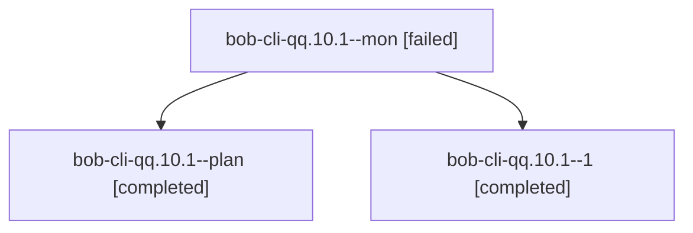

# Session: bob-cli-qq.10.1

[Agent Hoods](../README.md) / [bbugyi200](../users/bbugyi200/README.md) / [apollo](../users/bbugyi200/machines/apollo/README.md) / [bob-cli-qq](../users/bbugyi200/machines/apollo/hoods/bob-cli-qq/README.md) / bob-cli-qq.10.1

Owner: `bbugyi200.apollo` · Hood: `bob-cli-qq` · Members: 3 · Bead: [bob-cli-qq.10.1](https://github.com/bobs-org/bob-cli--beads/blob/main/pages/bob-cli-qq/bob-cli-qq.10.1.md)

## Lineage



The diagram is an optional enhancement; the ordered table below contains the same lineage in accessible text.

| Role | Agent | State | Model / provider | Timing | Commits | Prompt | Chat |
|---|---|---|---|---|---:|---|---|
| <a id="member-mon"></a>mon | bob-cli-qq.10.1--mon | failed | muse-spark-1.3-contributor / muse | 2026-11-27T14:46:00.495062+00:00 → 2026-11-27T14:50:33.967991+00:00 | 0 | — | [Chat](../agents/bbugyi200.apollo.bob-cli-qq.10.1--mon/chat.md) |
| <a id="member-plan"></a>plan | bob-cli-qq.10.1--plan | completed | muse-spark-1.3-contributor / muse | 2026-11-27T14:15:06.930438+00:00 → 2026-11-27T14:47:24.501948+00:00 | 0 | [Prompt](../agents/bbugyi200.apollo.bob-cli-qq.10.1--plan/prompt.md) | [Chat](../agents/bbugyi200.apollo.bob-cli-qq.10.1--plan/chat.md) |
| <a id="member-1"></a>1 | bob-cli-qq.10.1--1 | completed | muse-spark-1.3-contributor / muse | 2026-11-27T14:50:33.473636+00:00 → 2026-11-27T15:54:13.452211+00:00 | 0 | [Prompt](../agents/bbugyi200.apollo.bob-cli-qq.10.1--1/prompt.md) | [Chat](../agents/bbugyi200.apollo.bob-cli-qq.10.1--1/chat.md) |

## Variables

| Role | Variable | Value |
|---|---|---|
| 1 | `artifacts` | \[{bead: bob-cli-qq.10.1, kind: file, label: cabinets-perf-run1.json, path: /home/bryan/.sase/artifacts/agents/gh\_bobs-org\_\_bob-cli/20261127094944/cabinets-perf-run1-ea515082fc88.json, ref: file:expli… |

#### artifacts

**Role:** `1`

```yaml
- bead: bob-cli-qq.10.1
  kind: file
  label: cabinets-perf-run1.json
  path: /home/bryan/.sase/artifacts/agents/gh_bobs-org__bob-cli/20261127094944/cabinets-perf-run1-ea515082fc88.json
  ref: file:explicit:3a69f1836bc67ddc486f1621
  source_path: /tmp/perf-evidence-101/cabinets-perf-run1.json
- bead: bob-cli-qq.10.1
  kind: file
  label: cabinets-perf-run2.json
  path: /home/bryan/.sase/artifacts/agents/gh_bobs-org__bob-cli/20261127094944/cabinets-perf-run2-27b421cdce11.json
  ref: file:explicit:3b27faf3543ebb5b750e685f
  source_path: /tmp/perf-evidence-101/cabinets-perf-run2.json
- bead: bob-cli-qq.10.1
  kind: file
  label: cabinets-perf-shots.tar.gz
  path: /home/bryan/.sase/artifacts/agents/gh_bobs-org__bob-cli/20261127094944/cabinets-perf-shots.tar-8e5316a5a8ac.gz
  ref: file:explicit:67468d1c95e9bee47da0e9c0
  source_path: /tmp/perf-evidence-101/cabinets-perf-shots.tar.gz
- bead: bob-cli-qq.10.1
  kind: file
  label: cabinets-perf-clean.json
  path: /home/bryan/.sase/artifacts/agents/gh_bobs-org__bob-cli/20261127094944/cabinets-perf-clean-d389775c980c.json
  ref: file:explicit:d8f654f3081a6cedbf618286
  source_path: /tmp/perf-evidence-101/cabinets-perf-clean.json
- bead: bob-cli-qq.10.1
  kind: file
  label: cabinets-perf-fix7-run1.json
  path: /home/bryan/.sase/artifacts/agents/gh_bobs-org__bob-cli/20261127094944/cabinets-perf-run1-419980a4d69a.json
  ref: file:explicit:6cc489fc30c1c542ac28b45f
  source_path: /tmp/perf-evidence-102/cabinets-perf-run1.json
- bead: bob-cli-qq.10.1
  kind: file
  label: cabinets-perf-fix7-run2.json
  path: /home/bryan/.sase/artifacts/agents/gh_bobs-org__bob-cli/20261127094944/cabinets-perf-run2-4d39d59f4ede.json
  ref: file:explicit:123bdac55988a28deea913ed
  source_path: /tmp/perf-evidence-102/cabinets-perf-run2.json
- bead: bob-cli-qq.10.1
  kind: file
  label: cabinets-perf-fix7-shots.tar.gz
  path: /home/bryan/.sase/artifacts/agents/gh_bobs-org__bob-cli/20261127094944/cabinets-perf-shots.tar-a39092668634.gz
  ref: file:explicit:99cb2b63ed9f9cb99e085f58
  source_path: /tmp/perf-evidence-102/cabinets-perf-shots.tar.gz
```

Values are truncated for display; see each member's agent meta.json for the full values.

## Neighbors

| Agent | Relation | State |
|---|---|---|
| [bob-cli-qq.10.2](../agents/bbugyi200.apollo.bob-cli-qq.10.2/README.md) | bob-cli-qq.10 hood | completed |
| [bob-cli-qq.10.3](bbugyi200.apollo.bob-cli-qq.10.3.md) (session · 3) | bob-cli-qq.10 hood | completed 2, failed 1 |
| [bob-cli-qq.10.4](../agents/bbugyi200.apollo.bob-cli-qq.10.4/README.md) | bob-cli-qq.10 hood | completed |
| [bob-cli-qq.10.5](../agents/bbugyi200.apollo.bob-cli-qq.10.5/README.md) | bob-cli-qq.10 hood | completed |
| [bob-cli-qq.10.6](../agents/bbugyi200.apollo.bob-cli-qq.10.6/README.md) | bob-cli-qq.10 hood | completed |
| [bob-cli-qq.10.land](../agents/bbugyi200.apollo.bob-cli-qq.10.land/README.md) | bob-cli-qq.10 hood | waiting |
| [bob-cli-qq.1](bbugyi200.apollo.bob-cli-qq.1.md) (session · 13) | bob-cli-qq hood | completed 9, failed 4 |
| [bob-cli-qq.2](bbugyi200.apollo.bob-cli-qq.2.md) (session · 3) | bob-cli-qq hood | completed 3 |
| [bob-cli-qq.3](../agents/bbugyi200.apollo.bob-cli-qq.3/README.md) | bob-cli-qq hood | completed |
| [bob-cli-qq.4](bbugyi200.apollo.bob-cli-qq.4.md) (session · 5) | bob-cli-qq hood | completed 4, failed 1 |
| [bob-cli-qq.5](../agents/bbugyi200.apollo.bob-cli-qq.5/README.md) | bob-cli-qq hood | completed |
| [bob-cli-qq.6](../agents/bbugyi200.apollo.bob-cli-qq.6/README.md) | bob-cli-qq hood | completed |
| [bob-cli-qq.7](../agents/bbugyi200.apollo.bob-cli-qq.7/README.md) | bob-cli-qq hood | completed |
| [bob-cli-qq.8](bbugyi200.apollo.bob-cli-qq.8.md) (session · 16) | bob-cli-qq hood | completed 8, failed 8 |
| [bob-cli-qq.8](../agents/bbugyi200.apollo.bob-cli-qq.8/README.md) | bob-cli-qq hood | completed |
| [bob-cli-qq.9](../agents/bbugyi200.apollo.bob-cli-qq.9/README.md) | bob-cli-qq hood | waiting |
| [bob-cli-qq.land](../agents/bbugyi200.apollo.bob-cli-qq.land/README.md) | bob-cli-qq hood | waiting |
