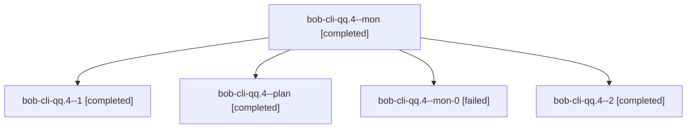

# Session: bob-cli-qq.4

[Agent Hoods](../README.md) / [bbugyi200](../users/bbugyi200/README.md) / [apollo](../users/bbugyi200/machines/apollo/README.md) / [bob-cli-qq](../users/bbugyi200/machines/apollo/hoods/bob-cli-qq/README.md) / bob-cli-qq.4

Owner: `bbugyi200.apollo` · Hood: `bob-cli-qq` · Members: 5 · Bead: [bob-cli-qq.4](https://github.com/bobs-org/bob-cli--beads/blob/main/pages/bob-cli-qq/bob-cli-qq.4.md)

## Lineage

The diagram is an optional enhancement; the ordered table below contains the same lineage in accessible text.

| Role | Agent | State | Model / provider | Timing | Commits | Prompt | Chat |
|---|---|---|---|---|---:|---|---|
| mon | bob-cli-qq.4--mon | completed | gpt-6-luna / codex | 2026-11-27T01:06:25.184496+00:00 → 2026-11-27T01:09:55.606245+00:00 | 0 | — | [Chat](../agents/bbugyi200.apollo.bob-cli-qq.4--mon/chat.md) |
| 1 | bob-cli-qq.4--1 | completed | gpt-6-luna / codex | 2026-11-27T01:09:55.275295+00:00 → 2026-11-27T01:14:08.825938+00:00 | 0 | [Prompt](../agents/bbugyi200.apollo.bob-cli-qq.4--1/prompt.md) | [Chat](../agents/bbugyi200.apollo.bob-cli-qq.4--1/chat.md) |
| plan | bob-cli-qq.4--plan | completed | gpt-6-luna / codex | 2026-11-27T00:25:06.007356+00:00 → 2026-11-27T01:07:46.164017+00:00 | 0 | [Prompt](../agents/bbugyi200.apollo.bob-cli-qq.4--plan/prompt.md) | [Chat](../agents/bbugyi200.apollo.bob-cli-qq.4--plan/chat.md) |
| mon-0 | bob-cli-qq.4--mon-0 | failed | gpt-6-luna / codex | 2026-11-27T01:13:01.478069+00:00 → 2026-11-27T01:16:19.398421+00:00 | 0 | — | [Chat](../agents/bbugyi200.apollo.bob-cli-qq.4--mon-0/chat.md) |
| 2 | bob-cli-qq.4--2 | completed | gpt-6-luna / codex | 2026-11-27T01:16:18.939142+00:00 → 2026-11-27T01:44:20.180736+00:00 | 0 | [Prompt](../agents/bbugyi200.apollo.bob-cli-qq.4--2/prompt.md) | [Chat](../agents/bbugyi200.apollo.bob-cli-qq.4--2/chat.md) |

## Neighbors

| Agent | Relation | State |
|---|---|---|
| [bob-cli-qq.1](bbugyi200.apollo.bob-cli-qq.1.md) (session · 13) | bob-cli-qq hood | completed 9, failed 4 |
| [bob-cli-qq.10.1](bbugyi200.apollo.bob-cli-qq.10.1.md) (session · 3) | bob-cli-qq hood | completed 2, failed 1 |
| [bob-cli-qq.10.1](../agents/bbugyi200.apollo.bob-cli-qq.10.1/README.md) | bob-cli-qq hood | completed |
| [bob-cli-qq.10.2](../agents/bbugyi200.apollo.bob-cli-qq.10.2/README.md) | bob-cli-qq hood | completed |
| [bob-cli-qq.10.3](bbugyi200.apollo.bob-cli-qq.10.3.md) (session · 3) | bob-cli-qq hood | completed 2, failed 1 |
| [bob-cli-qq.10.4](../agents/bbugyi200.apollo.bob-cli-qq.10.4/README.md) | bob-cli-qq hood | active |
| [bob-cli-qq.10.5](../agents/bbugyi200.apollo.bob-cli-qq.10.5/README.md) | bob-cli-qq hood | waiting |
| [bob-cli-qq.10.6](../agents/bbugyi200.apollo.bob-cli-qq.10.6/README.md) | bob-cli-qq hood | waiting |
| [bob-cli-qq.10.land](../agents/bbugyi200.apollo.bob-cli-qq.10.land/README.md) | bob-cli-qq hood | waiting |
| [bob-cli-qq.2](bbugyi200.apollo.bob-cli-qq.2.md) (session · 3) | bob-cli-qq hood | completed 3 |
| [bob-cli-qq.3](../agents/bbugyi200.apollo.bob-cli-qq.3/README.md) | bob-cli-qq hood | completed |
| [bob-cli-qq.5](../agents/bbugyi200.apollo.bob-cli-qq.5/README.md) | bob-cli-qq hood | completed |
| [bob-cli-qq.6](../agents/bbugyi200.apollo.bob-cli-qq.6/README.md) | bob-cli-qq hood | completed |
| [bob-cli-qq.7](../agents/bbugyi200.apollo.bob-cli-qq.7/README.md) | bob-cli-qq hood | completed |
| [bob-cli-qq.8](bbugyi200.apollo.bob-cli-qq.8.md) (session · 16) | bob-cli-qq hood | completed 8, failed 8 |
| [bob-cli-qq.8](../agents/bbugyi200.apollo.bob-cli-qq.8/README.md) | bob-cli-qq hood | completed |
| [bob-cli-qq.9](../agents/bbugyi200.apollo.bob-cli-qq.9/README.md) | bob-cli-qq hood | waiting |
| [bob-cli-qq.land](../agents/bbugyi200.apollo.bob-cli-qq.land/README.md) | bob-cli-qq hood | waiting |
