# Session: bob-cli-qq.8

[Agent Hoods](../README.md) / [bbugyi200](../users/bbugyi200/README.md) / [apollo](../users/bbugyi200/machines/apollo/README.md) / [bob-cli-qq](../users/bbugyi200/machines/apollo/hoods/bob-cli-qq/README.md) / bob-cli-qq.8

Owner: `bbugyi200.apollo` · Hood: `bob-cli-qq` · Members: 16 · Bead: [bob-cli-qq.8](https://github.com/bobs-org/bob-cli--beads/blob/main/pages/bob-cli-qq/bob-cli-qq.8.md)

## Lineage

```mermaid
flowchart TD
  n0["bob-cli-qq.8--3 [completed]"]
  n1["bob-cli-qq.8--2 [completed]"]
  n0 --> n1
  n2["bob-cli-qq.8--plan [completed]"]
  n0 --> n2
  n3["bob-cli-qq.8--mon-2 [failed]"]
  n0 --> n3
  n4["bob-cli-qq.8--5 [completed]"]
  n0 --> n4
  n5["bob-cli-qq.8--mon-3 [failed]"]
  n0 --> n5
  n6["bob-cli-qq.8--7 [completed]"]
  n0 --> n6
  n7["bob-cli-qq.8--4 [completed]"]
  n0 --> n7
  n8["bob-cli-qq.8--mon-1 [failed]"]
  n0 --> n8
  n9["bob-cli-qq.8--mon-6 [failed]"]
  n0 --> n9
  n10["bob-cli-qq.8--1 [completed]"]
  n0 --> n10
  n11["bob-cli-qq.8--mon [failed]"]
  n0 --> n11
  n12["bob-cli-qq.8--mon-5 [failed]"]
  n0 --> n12
  n13["bob-cli-qq.8--mon-4 [failed]"]
  n0 --> n13
  n14["bob-cli-qq.8--6 [completed]"]
  n0 --> n14
  n15["bob-cli-qq.8--mon-0 [failed]"]
  n0 --> n15
```

The diagram is an optional enhancement; the ordered table below contains the same lineage in accessible text.

| Role | Agent | State | Model / provider | Timing | Commits | Prompt | Chat |
|---|---|---|---|---|---:|---|---|
| 3 | bob-cli-qq.8--3 | completed | gpt-6-luna / codex | 2026-11-27T03:51:17.385170+00:00 → 2026-11-27T04:24:57.495511+00:00 | 0 | [Prompt](../agents/bbugyi200.apollo.bob-cli-qq.8--3/prompt.md) | [Chat](../agents/bbugyi200.apollo.bob-cli-qq.8--3/chat.md) |
| 2 | bob-cli-qq.8--2 | completed | gpt-6-luna / codex | 2026-11-27T03:36:18.477134+00:00 → 2026-11-27T03:50:37.041409+00:00 | 0 | [Prompt](../agents/bbugyi200.apollo.bob-cli-qq.8--2/prompt.md) | [Chat](../agents/bbugyi200.apollo.bob-cli-qq.8--2/chat.md) |
| plan | bob-cli-qq.8--plan | completed | gpt-6-luna / codex | 2026-11-27T02:49:34.759090+00:00 → 2026-11-27T03:15:28.014333+00:00 | 0 | [Prompt](../agents/bbugyi200.apollo.bob-cli-qq.8--plan/prompt.md) | [Chat](../agents/bbugyi200.apollo.bob-cli-qq.8--plan/chat.md) |
| mon-2 | bob-cli-qq.8--mon-2 | failed | gpt-6-luna / codex | 2026-11-27T04:22:49.478692+00:00 → 2026-11-27T04:27:11.254310+00:00 | 0 | — | [Chat](../agents/bbugyi200.apollo.bob-cli-qq.8--mon-2/chat.md) |
| 5 | bob-cli-qq.8--5 | completed | gpt-6-luna / codex | 2026-11-27T04:42:50.957981+00:00 → 2026-11-27T04:51:16.563395+00:00 | 0 | [Prompt](../agents/bbugyi200.apollo.bob-cli-qq.8--5/prompt.md) | [Chat](../agents/bbugyi200.apollo.bob-cli-qq.8--5/chat.md) |
| mon-3 | bob-cli-qq.8--mon-3 | failed | gpt-6-luna / codex | 2026-11-27T04:37:04.868326+00:00 → 2026-11-27T04:42:51.156472+00:00 | 0 | — | [Chat](../agents/bbugyi200.apollo.bob-cli-qq.8--mon-3/chat.md) |
| 7 | bob-cli-qq.8--7 | completed | gpt-6-luna / codex | 2026-11-27T05:23:03.256176+00:00 → 2026-11-27T06:00:03.683739+00:00 | 0 | [Prompt](../agents/bbugyi200.apollo.bob-cli-qq.8--7/prompt.md) | [Chat](../agents/bbugyi200.apollo.bob-cli-qq.8--7/chat.md) |
| 4 | bob-cli-qq.8--4 | completed | gpt-6-luna / codex | 2026-11-27T04:27:10.942613+00:00 → 2026-11-27T04:38:47.283643+00:00 | 0 | [Prompt](../agents/bbugyi200.apollo.bob-cli-qq.8--4/prompt.md) | [Chat](../agents/bbugyi200.apollo.bob-cli-qq.8--4/chat.md) |
| mon-1 | bob-cli-qq.8--mon-1 | failed | gpt-6-luna / codex | 2026-11-27T03:47:23.888805+00:00 → 2026-11-27T03:51:17.882017+00:00 | 0 | — | [Chat](../agents/bbugyi200.apollo.bob-cli-qq.8--mon-1/chat.md) |
| mon-6 | bob-cli-qq.8--mon-6 | failed | gpt-6-luna / codex | 2026-11-27T05:56:22.355698+00:00 → 2026-11-27T06:02:54.256997+00:00 | 0 | — | — |
| 1 | bob-cli-qq.8--1 | completed | gpt-6-luna / codex | 2026-11-27T03:17:38.242457+00:00 → 2026-11-27T03:31:12.689308+00:00 | 0 | [Prompt](../agents/bbugyi200.apollo.bob-cli-qq.8--1/prompt.md) | [Chat](../agents/bbugyi200.apollo.bob-cli-qq.8--1/chat.md) |
| mon | bob-cli-qq.8--mon | failed | gpt-6-luna / codex | 2026-11-27T03:13:25.394519+00:00 → 2026-11-27T03:17:38.604732+00:00 | 0 | — | [Chat](../agents/bbugyi200.apollo.bob-cli-qq.8--mon/chat.md) |
| mon-5 | bob-cli-qq.8--mon-5 | failed | gpt-6-luna / codex | 2026-11-27T05:15:23.862892+00:00 → 2026-11-27T05:23:03.508561+00:00 | 0 | — | [Chat](../agents/bbugyi200.apollo.bob-cli-qq.8--mon-5/chat.md) |
| mon-4 | bob-cli-qq.8--mon-4 | failed | gpt-6-luna / codex | 2026-11-27T04:49:12.133922+00:00 → 2026-11-27T04:55:18.479748+00:00 | 0 | — | [Chat](../agents/bbugyi200.apollo.bob-cli-qq.8--mon-4/chat.md) |
| 6 | bob-cli-qq.8--6 | completed | gpt-6-luna / codex | 2026-11-27T04:55:18.148884+00:00 → 2026-11-27T05:17:08.329988+00:00 | 0 | [Prompt](../agents/bbugyi200.apollo.bob-cli-qq.8--6/prompt.md) | [Chat](../agents/bbugyi200.apollo.bob-cli-qq.8--6/chat.md) |
| mon-0 | bob-cli-qq.8--mon-0 | failed | gpt-6-luna / codex | 2026-11-27T03:28:53.314934+00:00 → 2026-11-27T03:36:18.568980+00:00 | 0 | — | [Chat](../agents/bbugyi200.apollo.bob-cli-qq.8--mon-0/chat.md) |

## Neighbors

| Agent | Relation | State |
|---|---|---|
| [bob-cli-qq.1](bbugyi200.apollo.bob-cli-qq.1.md) (session · 13) | bob-cli-qq hood | completed 9, failed 4 |
| [bob-cli-qq.10.1](bbugyi200.apollo.bob-cli-qq.10.1.md) (session · 3) | bob-cli-qq hood | active 1, completed 1, failed 1 |
| [bob-cli-qq.10.2](../agents/bbugyi200.apollo.bob-cli-qq.10.2/README.md) | bob-cli-qq hood | completed |
| [bob-cli-qq.10.3](bbugyi200.apollo.bob-cli-qq.10.3.md) (session · 3) | bob-cli-qq hood | completed 2, failed 1 |
| [bob-cli-qq.10.4](../agents/bbugyi200.apollo.bob-cli-qq.10.4/README.md) | bob-cli-qq hood | waiting |
| [bob-cli-qq.10.5](../agents/bbugyi200.apollo.bob-cli-qq.10.5/README.md) | bob-cli-qq hood | waiting |
| [bob-cli-qq.10.6](../agents/bbugyi200.apollo.bob-cli-qq.10.6/README.md) | bob-cli-qq hood | waiting |
| [bob-cli-qq.10.land](../agents/bbugyi200.apollo.bob-cli-qq.10.land/README.md) | bob-cli-qq hood | waiting |
| [bob-cli-qq.2](bbugyi200.apollo.bob-cli-qq.2.md) (session · 3) | bob-cli-qq hood | completed 3 |
| [bob-cli-qq.3](../agents/bbugyi200.apollo.bob-cli-qq.3/README.md) | bob-cli-qq hood | completed |
| [bob-cli-qq.4](bbugyi200.apollo.bob-cli-qq.4.md) (session · 5) | bob-cli-qq hood | completed 4, failed 1 |
| [bob-cli-qq.5](../agents/bbugyi200.apollo.bob-cli-qq.5/README.md) | bob-cli-qq hood | completed |
| [bob-cli-qq.6](../agents/bbugyi200.apollo.bob-cli-qq.6/README.md) | bob-cli-qq hood | completed |
| [bob-cli-qq.7](../agents/bbugyi200.apollo.bob-cli-qq.7/README.md) | bob-cli-qq hood | completed |
| [bob-cli-qq.9](../agents/bbugyi200.apollo.bob-cli-qq.9/README.md) | bob-cli-qq hood | waiting |
| [bob-cli-qq.land](../agents/bbugyi200.apollo.bob-cli-qq.land/README.md) | bob-cli-qq hood | waiting |
