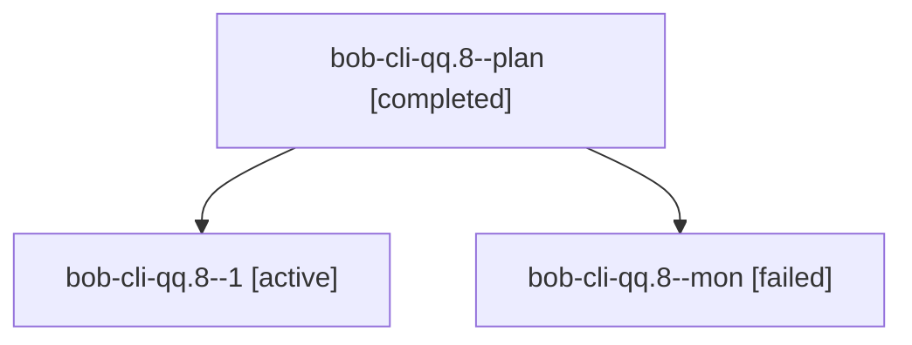

# Session: bob-cli-qq.8

[Agent Hoods](../README.md) / [bbugyi200](../users/bbugyi200/README.md) / [apollo](../users/bbugyi200/machines/apollo/README.md) / [bob-cli-qq](../users/bbugyi200/machines/apollo/hoods/bob-cli-qq/README.md) / bob-cli-qq.8

Owner: `bbugyi200.apollo` · Hood: `bob-cli-qq` · Members: 3 · Bead: [bob-cli-qq.8](https://github.com/bobs-org/bob-cli--beads/blob/main/pages/bob-cli-qq/bob-cli-qq.8.md)

## Lineage

The diagram is an optional enhancement; the ordered table below contains the same lineage in accessible text.

| Role | Agent | State | Model / provider | Timing | Commits | Prompt | Chat |
|---|---|---|---|---|---:|---|---|
| plan | bob-cli-qq.8--plan | completed | gpt-6-luna / codex | 2026-11-27T02:49:34.759090+00:00 → 2026-11-27T03:15:28.014333+00:00 | 0 | [Prompt](../agents/bbugyi200.apollo.bob-cli-qq.8--plan/prompt.md) | [Chat](../agents/bbugyi200.apollo.bob-cli-qq.8--plan/chat.md) |
| 1 | bob-cli-qq.8--1 | active | gpt-6-luna / codex | 2026-11-27T03:17:38.242457+00:00 | 0 | [Prompt](../agents/bbugyi200.apollo.bob-cli-qq.8--1/prompt.md) | — |
| mon | bob-cli-qq.8--mon | failed | gpt-6-luna / codex | 2026-11-27T03:13:25.394519+00:00 → 2026-11-27T03:17:38.604732+00:00 | 0 | — | [Chat](../agents/bbugyi200.apollo.bob-cli-qq.8--mon/chat.md) |

## Neighbors

| Agent | Relation | State |
|---|---|---|
| [bob-cli-qq.1](bbugyi200.apollo.bob-cli-qq.1.md) (session · 13) | bob-cli-qq hood | completed 9, failed 4 |
| [bob-cli-qq.2](bbugyi200.apollo.bob-cli-qq.2.md) (session · 3) | bob-cli-qq hood | completed 3 |
| [bob-cli-qq.3](../agents/bbugyi200.apollo.bob-cli-qq.3/README.md) | bob-cli-qq hood | completed |
| [bob-cli-qq.4](bbugyi200.apollo.bob-cli-qq.4.md) (session · 5) | bob-cli-qq hood | completed 4, failed 1 |
| [bob-cli-qq.5](../agents/bbugyi200.apollo.bob-cli-qq.5/README.md) | bob-cli-qq hood | completed |
| [bob-cli-qq.6](../agents/bbugyi200.apollo.bob-cli-qq.6/README.md) | bob-cli-qq hood | completed |
| [bob-cli-qq.7](../agents/bbugyi200.apollo.bob-cli-qq.7/README.md) | bob-cli-qq hood | completed |
| [bob-cli-qq.9](../agents/bbugyi200.apollo.bob-cli-qq.9/README.md) | bob-cli-qq hood | waiting |
| [bob-cli-qq.land](../agents/bbugyi200.apollo.bob-cli-qq.land/README.md) | bob-cli-qq hood | waiting |
