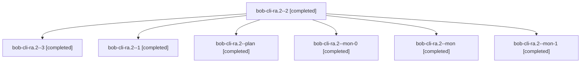

# Session: bob-cli-ra.2

[Agent Hoods](../README.md) / [bbugyi200](../users/bbugyi200/README.md) / [apollo](../users/bbugyi200/machines/apollo/README.md) / [bob-cli-ra](../users/bbugyi200/machines/apollo/hoods/bob-cli-ra/README.md) / bob-cli-ra.2

Owner: `bbugyi200.apollo` · Hood: `bob-cli-ra` · Members: 7 · Bead: [bob-cli-ra.2](https://github.com/bobs-org/bob-cli--beads/blob/main/pages/bob-cli-ra/bob-cli-ra.2.md)

## Lineage

The diagram is an optional enhancement; the ordered table below contains the same lineage in accessible text.

| Role | Agent | State | Model / provider | Timing | Commits | Prompt | Chat |
|---|---|---|---|---|---:|---|---|
| 2 | bob-cli-ra.2--2 | completed | gpt-6-luna / codex | 2026-11-27T22:20:19.434779+00:00 → 2026-11-27T22:27:39.447547+00:00 | 0 | [Prompt](../agents/bbugyi200.apollo.bob-cli-ra.2--2/prompt.md) | [Chat](../agents/bbugyi200.apollo.bob-cli-ra.2--2/chat.md) |
| 3 | bob-cli-ra.2--3 | completed | gpt-6-luna / codex | 2026-11-27T22:37:34.117028+00:00 → 2026-11-27T22:42:06.951398+00:00 | 0 | [Prompt](../agents/bbugyi200.apollo.bob-cli-ra.2--3/prompt.md) | [Chat](../agents/bbugyi200.apollo.bob-cli-ra.2--3/chat.md) |
| 1 | bob-cli-ra.2--1 | completed | gpt-6-luna / codex | 2026-11-27T21:44:15.237208+00:00 → 2026-11-27T22:00:23.381684+00:00 | 0 | [Prompt](../agents/bbugyi200.apollo.bob-cli-ra.2--1/prompt.md) | [Chat](../agents/bbugyi200.apollo.bob-cli-ra.2--1/chat.md) |
| plan | bob-cli-ra.2--plan | completed | gpt-6-luna / codex | 2026-11-27T21:13:23.847330+00:00 → 2026-11-27T21:41:59.623735+00:00 | 0 | [Prompt](../agents/bbugyi200.apollo.bob-cli-ra.2--plan/prompt.md) | [Chat](../agents/bbugyi200.apollo.bob-cli-ra.2--plan/chat.md) |
| mon-0 | bob-cli-ra.2--mon-0 | completed | gpt-6-luna / codex | 2026-11-27T21:59:06.931917+00:00 → 2026-11-27T22:20:19.768552+00:00 | 0 | — | [Chat](../agents/bbugyi200.apollo.bob-cli-ra.2--mon-0/chat.md) |
| mon | bob-cli-ra.2--mon | completed | gpt-6-luna / codex | 2026-11-27T21:39:10.284300+00:00 → 2026-11-27T21:44:15.714488+00:00 | 0 | — | [Chat](../agents/bbugyi200.apollo.bob-cli-ra.2--mon/chat.md) |
| mon-1 | bob-cli-ra.2--mon-1 | completed | gpt-6-luna / codex | 2026-11-27T22:26:39.060527+00:00 → 2026-11-27T22:37:34.631936+00:00 | 0 | — | [Chat](../agents/bbugyi200.apollo.bob-cli-ra.2--mon-1/chat.md) |

## Neighbors

| Agent | Relation | State |
|---|---|---|
| [bob-cli-ra.1](../agents/bbugyi200.apollo.bob-cli-ra.1/README.md) | bob-cli-ra hood | completed |
| [bob-cli-ra.3](../agents/bbugyi200.apollo.bob-cli-ra.3/README.md) | bob-cli-ra hood | completed |
| [bob-cli-ra.4](../agents/bbugyi200.apollo.bob-cli-ra.4/README.md) | bob-cli-ra hood | completed |
| [bob-cli-ra.5](bbugyi200.apollo.bob-cli-ra.5.md) (session · 11) | bob-cli-ra hood | active 1, completed 5, failed 5 |
| [bob-cli-ra.6](../agents/bbugyi200.apollo.bob-cli-ra.6/README.md) | bob-cli-ra hood | waiting |
| [bob-cli-ra.land](../agents/bbugyi200.apollo.bob-cli-ra.land/README.md) | bob-cli-ra hood | waiting |
