# Session: bob-cli-ra.5

[Agent Hoods](../README.md) / [bbugyi200](../users/bbugyi200/README.md) / [apollo](../users/bbugyi200/machines/apollo/README.md) / [bob-cli-ra](../users/bbugyi200/machines/apollo/hoods/bob-cli-ra/README.md) / bob-cli-ra.5

Owner: `bbugyi200.apollo` · Hood: `bob-cli-ra` · Members: 13 · Bead: [bob-cli-ra.5](https://github.com/bobs-org/bob-cli--beads/blob/main/pages/bob-cli-ra/bob-cli-ra.5.md)

## Lineage

```mermaid
flowchart TD
  n0["bob-cli-ra.5--mon-2 [failed]"]
  n1["bob-cli-ra.5--1 [completed]"]
  n0 --> n1
  n2["bob-cli-ra.5--2 [completed]"]
  n0 --> n2
  n3["bob-cli-ra.5--plan [completed]"]
  n0 --> n3
  n4["bob-cli-ra.5--mon-4 [active]"]
  n0 --> n4
  n5["bob-cli-ra.5--4 [completed]"]
  n0 --> n5
  n6["bob-cli-ra.5--5 [completed]"]
  n0 --> n6
  n7["bob-cli-ra.5--mon-3 [failed]"]
  n0 --> n7
  n8["bob-cli-ra.5--mon-0 [failed]"]
  n0 --> n8
  n9["bob-cli-ra.5--mon-1 [failed]"]
  n0 --> n9
  n10["bob-cli-ra.5--mon [failed]"]
  n0 --> n10
  n11["bob-cli-ra.5--3 [completed]"]
  n0 --> n11
  n12["bob-cli-ra.5--6 [active]"]
  n0 --> n12
```

The diagram is an optional enhancement; the ordered table below contains the same lineage in accessible text.

| Role | Agent | State | Model / provider | Timing | Commits | Prompt | Chat |
|---|---|---|---|---|---:|---|---|
| mon-2 | bob-cli-ra.5--mon-2 | failed | gpt-6-luna / codex | 2026-11-28T00:43:48.062270+00:00 → 2026-11-28T00:47:47.941612+00:00 | 0 | — | [Chat](../agents/bbugyi200.apollo.bob-cli-ra.5--mon-2/chat.md) |
| 1 | bob-cli-ra.5--1 | completed | gpt-6-luna / codex | 2026-11-28T00:09:16.883472+00:00 → 2026-11-28T00:20:29.010465+00:00 | 0 | [Prompt](../agents/bbugyi200.apollo.bob-cli-ra.5--1/prompt.md) | [Chat](../agents/bbugyi200.apollo.bob-cli-ra.5--1/chat.md) |
| 2 | bob-cli-ra.5--2 | completed | gpt-6-luna / codex | 2026-11-28T00:23:04.937381+00:00 → 2026-11-28T00:33:16.269293+00:00 | 0 | [Prompt](../agents/bbugyi200.apollo.bob-cli-ra.5--2/prompt.md) | [Chat](../agents/bbugyi200.apollo.bob-cli-ra.5--2/chat.md) |
| plan | bob-cli-ra.5--plan | completed | gpt-6-luna / codex | 2026-11-27T23:12:26.936712+00:00 → 2026-11-28T00:07:07.222352+00:00 | 0 | [Prompt](../agents/bbugyi200.apollo.bob-cli-ra.5--plan/prompt.md) | [Chat](../agents/bbugyi200.apollo.bob-cli-ra.5--plan/chat.md) |
| mon-4 | bob-cli-ra.5--mon-4 | active | gpt-6-luna / codex | 2026-11-28T01:09:12.933512+00:00 | 0 | — | — |
| 4 | bob-cli-ra.5--4 | completed | gpt-6-luna / codex | 2026-11-28T00:47:47.835008+00:00 → 2026-11-28T00:59:06.316748+00:00 | 0 | [Prompt](../agents/bbugyi200.apollo.bob-cli-ra.5--4/prompt.md) | [Chat](../agents/bbugyi200.apollo.bob-cli-ra.5--4/chat.md) |
| 5 | bob-cli-ra.5--5 | completed | gpt-6-luna / codex | 2026-11-28T01:02:29.970267+00:00 → 2026-11-28T01:11:07.873136+00:00 | 0 | [Prompt](../agents/bbugyi200.apollo.bob-cli-ra.5--5/prompt.md) | [Chat](../agents/bbugyi200.apollo.bob-cli-ra.5--5/chat.md) |
| mon-3 | bob-cli-ra.5--mon-3 | failed | gpt-6-luna / codex | 2026-11-28T00:57:07.329744+00:00 → 2026-11-28T01:02:30.331730+00:00 | 0 | — | [Chat](../agents/bbugyi200.apollo.bob-cli-ra.5--mon-3/chat.md) |
| mon-0 | bob-cli-ra.5--mon-0 | failed | gpt-6-luna / codex | 2026-11-28T00:19:44.464628+00:00 → 2026-11-28T00:23:05.010923+00:00 | 0 | — | [Chat](../agents/bbugyi200.apollo.bob-cli-ra.5--mon-0/chat.md) |
| mon-1 | bob-cli-ra.5--mon-1 | failed | gpt-6-luna / codex | 2026-11-28T00:31:29.176756+00:00 → 2026-11-28T00:36:36.846583+00:00 | 0 | — | [Chat](../agents/bbugyi200.apollo.bob-cli-ra.5--mon-1/chat.md) |
| mon | bob-cli-ra.5--mon | failed | gpt-6-luna / codex | 2026-11-27T23:47:41.611569+00:00 → 2026-11-28T00:09:17.347502+00:00 | 0 | — | [Chat](../agents/bbugyi200.apollo.bob-cli-ra.5--mon/chat.md) |
| 3 | bob-cli-ra.5--3 | completed | gpt-6-luna / codex | 2026-11-28T00:36:36.782976+00:00 → 2026-11-28T00:44:51.507016+00:00 | 0 | [Prompt](../agents/bbugyi200.apollo.bob-cli-ra.5--3/prompt.md) | [Chat](../agents/bbugyi200.apollo.bob-cli-ra.5--3/chat.md) |
| 6 | bob-cli-ra.5--6 | active | gpt-6-luna / codex | 2026-11-28T01:14:26.435660+00:00 | 0 | [Prompt](../agents/bbugyi200.apollo.bob-cli-ra.5--6/prompt.md) | — |

## Neighbors

| Agent | Relation | State |
|---|---|---|
| [bob-cli-ra.1](../agents/bbugyi200.apollo.bob-cli-ra.1/README.md) | bob-cli-ra hood | completed |
| [bob-cli-ra.2](bbugyi200.apollo.bob-cli-ra.2.md) (session · 7) | bob-cli-ra hood | completed 7 |
| [bob-cli-ra.3](../agents/bbugyi200.apollo.bob-cli-ra.3/README.md) | bob-cli-ra hood | completed |
| [bob-cli-ra.4](../agents/bbugyi200.apollo.bob-cli-ra.4/README.md) | bob-cli-ra hood | completed |
| [bob-cli-ra.6](../agents/bbugyi200.apollo.bob-cli-ra.6/README.md) | bob-cli-ra hood | completed |
| [bob-cli-ra.land](../agents/bbugyi200.apollo.bob-cli-ra.land/README.md) | bob-cli-ra hood | waiting |
