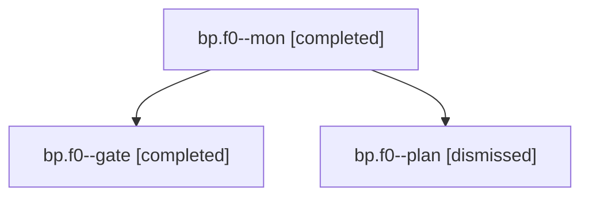

# Session: bp.f0

[Agent Hoods](../README.md) / [bbugyi200](../users/bbugyi200/README.md) / [apollo](../users/bbugyi200/machines/apollo/README.md) / [bp](../users/bbugyi200/machines/apollo/hoods/bp/README.md) / bp.f0

Owner: `bbugyi200.apollo` · Hood: `bp` · Members: 3

## Lineage

The diagram is an optional enhancement; the ordered table below contains the same lineage in accessible text.

| Role | Agent | State | Model / provider | Timing | Commits | Prompt | Chat |
|---|---|---|---|---|---:|---|---|
| mon | bp.f0--mon | completed | opus / claude | 2026-10-31T16:00:58.036592+00:00 → 2026-10-31T16:02:38.458427+00:00 | 0 | — | [Chat](../agents/bbugyi200.apollo.bp.f0--mon/chat.md) |
| gate | bp.f0--gate | completed | opus / claude | 2026-10-31T16:00:36.831809+00:00 → 2026-10-31T16:01:04.458374+00:00 | 0 | — | [Chat](../agents/bbugyi200.apollo.bp.f0--gate/chat.md) |
| plan | bp.f0--plan | dismissed | opus / claude | 2026-10-31T11:31:56.718819 → 2026-10-31T11:59:42.500492 | 0 | [Prompt](../agents/bbugyi200.apollo.bp.f0--plan/prompt.md) | [Chat](../agents/bbugyi200.apollo.bp.f0--plan/chat.md) |

## Neighbors

| Agent | Relation | State |
|---|---|---|
| [bp](bbugyi200.apollo.bp.md) (session · 3) | ancestor | completed 2, dismissed 1 |
