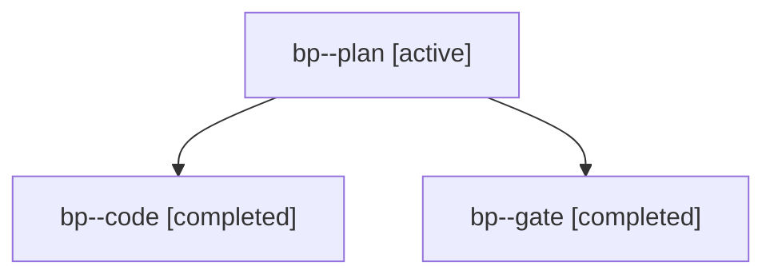

# Session: bp

[Agent Hoods](../README.md) / [bbugyi200](../users/bbugyi200/README.md) / [apollo](../users/bbugyi200/machines/apollo/README.md) / [bp](../users/bbugyi200/machines/apollo/hoods/bp/README.md) / bp

Owner: `bbugyi200.apollo` · Hood: `bp` · Members: 3

## Lineage

The diagram is an optional enhancement; the ordered table below contains the same lineage in accessible text.

| Role | Agent | State | Model / provider | Timing | Commits | Prompt | Chat |
|---|---|---|---|---|---:|---|---|
| plan | bp--plan | active | opus / claude | 2026-10-31T14:23:04.773464+00:00 | 0 | [Prompt](../agents/bbugyi200.apollo.bp--plan/prompt.md) | [Chat](../agents/bbugyi200.apollo.bp--plan/chat.md) |
| code | bp--code | completed | gpt-6-luna / codex | 2026-10-31T14:42:08.609870+00:00 → 2026-10-31T15:18:04.967265+00:00 | [1](../agents/bbugyi200.apollo.bp--code/README.md#commits) | [Prompt](../agents/bbugyi200.apollo.bp--code/prompt.md) | [Chat](../agents/bbugyi200.apollo.bp--code/chat.md) |
| gate | bp--gate | completed | opus / claude | 2026-10-31T14:40:59.654051+00:00 → 2026-10-31T14:41:39.481671+00:00 | 0 | — | [Chat](../agents/bbugyi200.apollo.bp--gate/chat.md) |

## Commits

| Role | Repo | Commit | Subject | Committed |
|---|---|---|---|---|
| code | bob-cli | [`fc1e449`](https://github.com/bobs-org/bob-cli/commit/fc1e449fa14cdf769aabc13228dea4325e59a608) | feat(capture): support plus block-ID separators | 2026-10-31 11:17:25 EDT |

## Neighbors

| Agent | Relation | State |
|---|---|---|
| [bp.f0](bbugyi200.apollo.bp.f0.md) (session · 3) | descendant | active 1, completed 2 |
