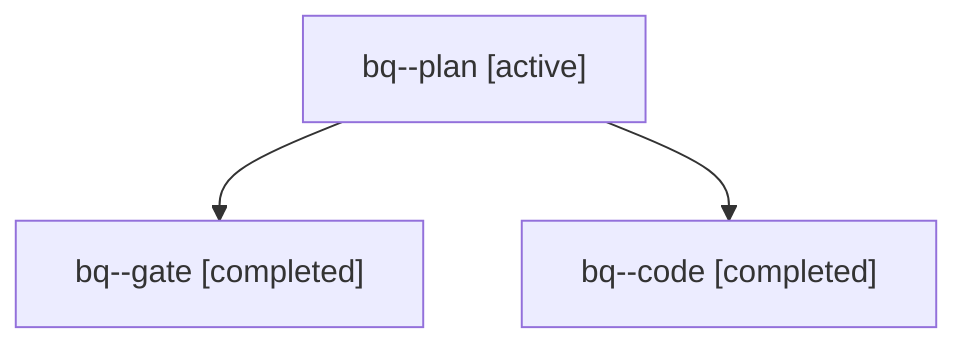

# Session: bq

[Agent Hoods](../README.md) / [bbugyi200](../users/bbugyi200/README.md) / [apollo](../users/bbugyi200/machines/apollo/README.md) / [bq](../users/bbugyi200/machines/apollo/hoods/bq/README.md) / bq

Owner: `bbugyi200.apollo` · Hood: `bq` · Members: 3

## Lineage

The diagram is an optional enhancement; the ordered table below contains the same lineage in accessible text.

| Role | Agent | State | Model / provider | Timing | Commits | Prompt | Chat |
|---|---|---|---|---|---:|---|---|
| plan | bq--plan | active | opus / claude | 2026-10-31T15:25:34.287262+00:00 | 0 | [Prompt](../agents/bbugyi200.apollo.bq--plan/prompt.md) | [Chat](../agents/bbugyi200.apollo.bq--plan/chat.md) |
| gate | bq--gate | completed | opus / claude | 2026-10-31T15:37:23.087686+00:00 → 2026-10-31T15:37:57.512699+00:00 | 0 | — | [Chat](../agents/bbugyi200.apollo.bq--gate/chat.md) |
| code | bq--code | completed | grok-4.6 / grok | 2026-10-31T15:38:15.088431+00:00 → 2026-10-31T16:11:16.984573+00:00 | 0 | [Prompt](../agents/bbugyi200.apollo.bq--code/prompt.md) | [Chat](../agents/bbugyi200.apollo.bq--code/chat.md) |
