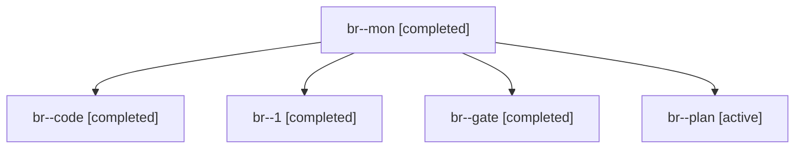

# Session: br

[Agent Hoods](../README.md) / [bbugyi200](../users/bbugyi200/README.md) / [apollo](../users/bbugyi200/machines/apollo/README.md) / [br](../users/bbugyi200/machines/apollo/hoods/br/README.md) / br

Owner: `bbugyi200.apollo` · Hood: `br` · Members: 5

## Lineage

The diagram is an optional enhancement; the ordered table below contains the same lineage in accessible text.

| Role | Agent | State | Model / provider | Timing | Commits | Prompt | Chat |
|---|---|---|---|---|---:|---|---|
| mon | br--mon | completed | grok-4.6 / grok | 2026-10-31T16:49:27.074908+00:00 → 2026-10-31T16:53:30.268156+00:00 | 0 | — | [Chat](../agents/bbugyi200.apollo.br--mon/chat.md) |
| code | br--code | completed | grok-4.6 / grok | 2026-10-31T16:21:56.399601+00:00 → 2026-10-31T16:49:45.251452+00:00 | 0 | [Prompt](../agents/bbugyi200.apollo.br--code/prompt.md) | [Chat](../agents/bbugyi200.apollo.br--code/chat.md) |
| 1 | br--1 | completed | grok-4.6 / grok | 2026-10-31T16:53:30.101862+00:00 → 2026-10-31T17:09:07.136423+00:00 | [1](../agents/bbugyi200.apollo.br--1/README.md#commits) | [Prompt](../agents/bbugyi200.apollo.br--1/prompt.md) | [Chat](../agents/bbugyi200.apollo.br--1/chat.md) |
| gate | br--gate | completed | opus / claude | 2026-10-31T16:21:12.669569+00:00 → 2026-10-31T16:21:38.772294+00:00 | 0 | — | [Chat](../agents/bbugyi200.apollo.br--gate/chat.md) |
| plan | br--plan | active | opus / claude | 2026-10-31T16:04:10.690332+00:00 | 0 | [Prompt](../agents/bbugyi200.apollo.br--plan/prompt.md) | [Chat](../agents/bbugyi200.apollo.br--plan/chat.md) |

## Commits

| Role | Repo | Commit | Subject | Committed |
|---|---|---|---|---|
| 1 | bob-cli | [`e69128e`](https://github.com/bobs-org/bob-cli/commit/e69128e87039dc26ad06fef0725b7d320d4d20e4) | feat(gcal): reroute unedited Event Task roots when Google's route changes | 2026-10-31 13:08:47 EDT |
