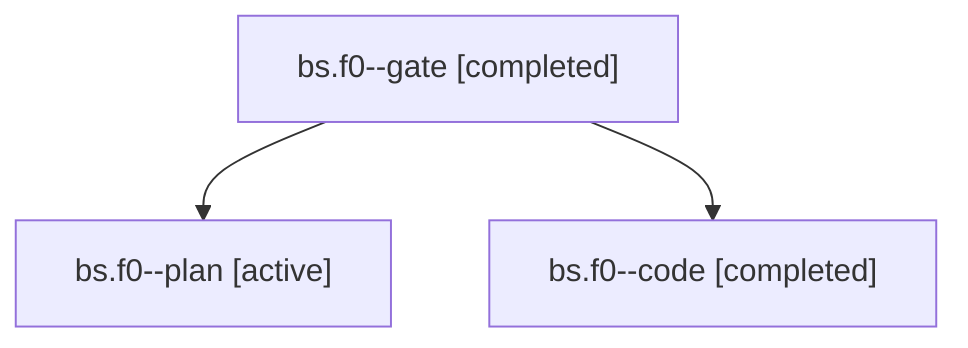

# Session: bs.f0

[Agent Hoods](../README.md) / [bbugyi200](../users/bbugyi200/README.md) / [apollo](../users/bbugyi200/machines/apollo/README.md) / [bs](../users/bbugyi200/machines/apollo/hoods/bs/README.md) / bs.f0

Owner: `bbugyi200.apollo` · Hood: `bs` · Members: 3

## Lineage

The diagram is an optional enhancement; the ordered table below contains the same lineage in accessible text.

| Role | Agent | State | Model / provider | Timing | Commits | Prompt | Chat |
|---|---|---|---|---|---:|---|---|
| gate | bs.f0--gate | completed | opus / claude | 2026-11-01T13:24:49.656406+00:00 → 2026-11-01T13:25:20.859189+00:00 | 0 | — | [Chat](../agents/bbugyi200.apollo.bs.f0--gate/chat.md) |
| plan | bs.f0--plan | active | opus / claude | 2026-11-01T13:04:51.191090+00:00 | 0 | [Prompt](../agents/bbugyi200.apollo.bs.f0--plan/prompt.md) | [Chat](../agents/bbugyi200.apollo.bs.f0--plan/chat.md) |
| code | bs.f0--code | completed | grok-4.6 / grok | 2026-11-01T13:25:51.099500+00:00 → 2026-11-01T13:49:19.099916+00:00 | [1](../agents/bbugyi200.apollo.bs.f0--code/README.md#commits) | [Prompt](../agents/bbugyi200.apollo.bs.f0--code/prompt.md) | [Chat](../agents/bbugyi200.apollo.bs.f0--code/chat.md) |

## Commits

| Role | Repo | Commit | Subject | Committed |
|---|---|---|---|---|
| code | bob-cli | [`81b3b5a`](https://github.com/bobs-org/bob-cli/commit/81b3b5a4964547e187dd996db178211eab856fec) | docs(gkeep): footer inbox tray counts the inbox tree | 2026-11-01 08:48:23 EST |

## Neighbors

| Agent | Relation | State |
|---|---|---|
| [bs](bbugyi200.apollo.bs.md) (session · 3) | ancestor | active 1, completed 2 |
