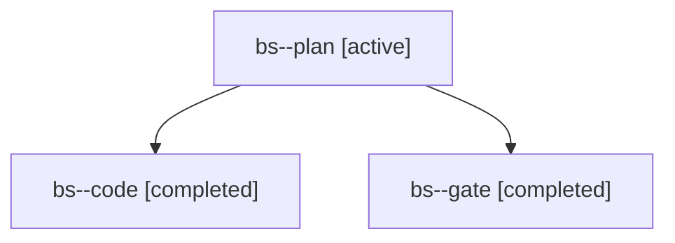

# Session: bs

[Agent Hoods](../README.md) / [bbugyi200](../users/bbugyi200/README.md) / [apollo](../users/bbugyi200/machines/apollo/README.md) / [bs](../users/bbugyi200/machines/apollo/hoods/bs/README.md) / bs

Owner: `bbugyi200.apollo` · Hood: `bs` · Members: 3

## Lineage

The diagram is an optional enhancement; the ordered table below contains the same lineage in accessible text.

| Role | Agent | State | Model / provider | Timing | Commits | Prompt | Chat |
|---|---|---|---|---|---:|---|---|
| plan | bs--plan | active | opus / claude | 2026-11-01T12:21:41.441629+00:00 | 0 | [Prompt](../agents/bbugyi200.apollo.bs--plan/prompt.md) | [Chat](../agents/bbugyi200.apollo.bs--plan/chat.md) |
| code | bs--code | completed | grok-4.6 / grok | 2026-11-01T12:34:57.475047+00:00 → 2026-11-01T12:51:26.548538+00:00 | [1](../agents/bbugyi200.apollo.bs--code/README.md#commits) | [Prompt](../agents/bbugyi200.apollo.bs--code/prompt.md) | [Chat](../agents/bbugyi200.apollo.bs--code/chat.md) |
| gate | bs--gate | completed | opus / claude | 2026-11-01T12:34:12.345643+00:00 → 2026-11-01T12:34:40.605837+00:00 | 0 | — | [Chat](../agents/bbugyi200.apollo.bs--gate/chat.md) |

## Commits

| Role | Repo | Commit | Subject | Committed |
|---|---|---|---|---|
| code | bob-cli | [`9625c9a`](https://github.com/bobs-org/bob-cli/commit/9625c9ac44d77e7b9fa95de84b6ed8676c58bd6e) | docs(gkeep): note the footer hides zero counts | 2026-11-01 07:51:05 EST |

## Neighbors

| Agent | Relation | State |
|---|---|---|
| [bs.f0](bbugyi200.apollo.bs.f0.md) (session · 3) | descendant | active 1, completed 2 |
