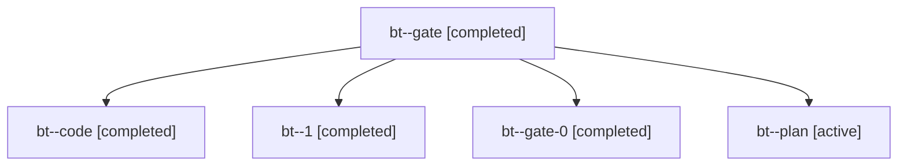

# Session: bt

[Agent Hoods](../README.md) / [bbugyi200](../users/bbugyi200/README.md) / [apollo](../users/bbugyi200/machines/apollo/README.md) / [bt](../users/bbugyi200/machines/apollo/hoods/bt/README.md) / bt

Owner: `bbugyi200.apollo` · Hood: `bt` · Members: 5

## Lineage

The diagram is an optional enhancement; the ordered table below contains the same lineage in accessible text.

| Role | Agent | State | Model / provider | Timing | Commits | Prompt | Chat |
|---|---|---|---|---|---:|---|---|
| gate | bt--gate | completed | opus / claude | 2026-11-01T15:28:31.241745+00:00 → 2026-11-01T15:29:10.192802+00:00 | 0 | — | [Chat](../agents/bbugyi200.apollo.bt--gate/chat.md) |
| code | bt--code | completed | gpt-6-luna / codex | 2026-11-01T15:29:27.456904+00:00 → 2026-11-01T16:08:07.160484+00:00 | 0 | [Prompt](../agents/bbugyi200.apollo.bt--code/prompt.md) | [Chat](../agents/bbugyi200.apollo.bt--code/chat.md) |
| 1 | bt--1 | completed | gpt-6-luna / codex | 2026-11-01T16:10:16.227878+00:00 → 2026-11-01T16:34:41.746645+00:00 | [1](../agents/bbugyi200.apollo.bt--1/README.md#commits) | [Prompt](../agents/bbugyi200.apollo.bt--1/prompt.md) | [Chat](../agents/bbugyi200.apollo.bt--1/chat.md) |
| gate-0 | bt--gate-0 | completed | gpt-6-luna / codex | 2026-11-01T16:09:01.036355+00:00 → 2026-11-01T16:09:26.057510+00:00 | 0 | — | [Chat](../agents/bbugyi200.apollo.bt--gate-0/chat.md) |
| plan | bt--plan | active | opus / claude | 2026-11-01T15:19:25.563537+00:00 | 0 | [Prompt](../agents/bbugyi200.apollo.bt--plan/prompt.md) | [Chat](../agents/bbugyi200.apollo.bt--plan/chat.md) |

## Commits

| Role | Repo | Commit | Subject | Committed |
|---|---|---|---|---|
| 1 | bob-cli | [`5546ed1`](https://github.com/bobs-org/bob-cli/commit/5546ed1a2e86703bf6b325c7051c69fa6cb67b9b) | docs(freshness): document optional Next keep reasons | 2026-11-01 11:25:09 EST |
