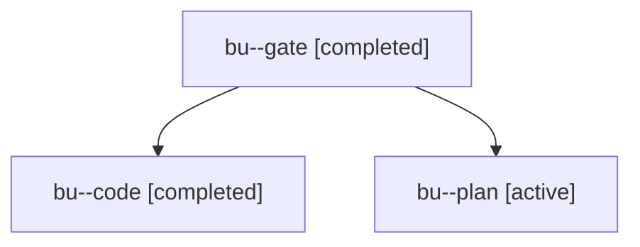

# Session: bu

[Agent Hoods](../README.md) / [bbugyi200](../users/bbugyi200/README.md) / [apollo](../users/bbugyi200/machines/apollo/README.md) / [bu](../users/bbugyi200/machines/apollo/hoods/bu/README.md) / bu

Owner: `bbugyi200.apollo` · Hood: `bu` · Members: 3

## Lineage

The diagram is an optional enhancement; the ordered table below contains the same lineage in accessible text.

| Role | Agent | State | Model / provider | Timing | Commits | Prompt | Chat |
|---|---|---|---|---|---:|---|---|
| gate | bu--gate | completed | opus / claude | 2026-11-01T15:28:58.223686+00:00 → 2026-11-01T15:29:26.167722+00:00 | 0 | — | [Chat](../agents/bbugyi200.apollo.bu--gate/chat.md) |
| code | bu--code | completed | muse-spark-1.3-contributor / muse | 2026-11-01T15:29:43.736749+00:00 → 2026-11-01T15:46:25.932753+00:00 | 0 | [Prompt](../agents/bbugyi200.apollo.bu--code/prompt.md) | [Chat](../agents/bbugyi200.apollo.bu--code/chat.md) |
| plan | bu--plan | active | opus / claude | 2026-11-01T15:23:40.040042+00:00 | 0 | [Prompt](../agents/bbugyi200.apollo.bu--plan/prompt.md) | [Chat](../agents/bbugyi200.apollo.bu--plan/chat.md) |
