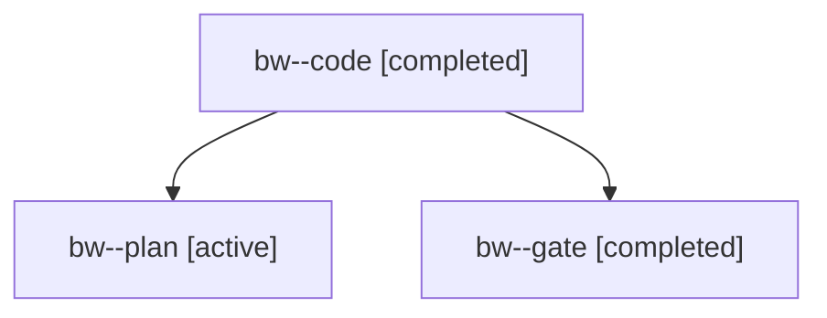

# Session: bw

[Agent Hoods](../README.md) / [bbugyi200](../users/bbugyi200/README.md) / [apollo](../users/bbugyi200/machines/apollo/README.md) / [bw](../users/bbugyi200/machines/apollo/hoods/bw/README.md) / bw

Owner: `bbugyi200.apollo` · Hood: `bw` · Members: 3

## Lineage

The diagram is an optional enhancement; the ordered table below contains the same lineage in accessible text.

| Role | Agent | State | Model / provider | Timing | Commits | Prompt | Chat |
|---|---|---|---|---|---:|---|---|
| code | bw--code | completed | grok-4.6 / grok | 2026-11-01T16:34:10.514177+00:00 → 2026-11-01T17:17:30.947360+00:00 | [1](../agents/bbugyi200.apollo.bw--code/README.md#commits) | [Prompt](../agents/bbugyi200.apollo.bw--code/prompt.md) | [Chat](../agents/bbugyi200.apollo.bw--code/chat.md) |
| plan | bw--plan | active | opus / claude | 2026-11-01T16:21:26.770459+00:00 | 0 | [Prompt](../agents/bbugyi200.apollo.bw--plan/prompt.md) | [Chat](../agents/bbugyi200.apollo.bw--plan/chat.md) |
| gate | bw--gate | completed | opus / claude | 2026-11-01T16:33:24.616367+00:00 → 2026-11-01T16:33:53.230196+00:00 | 0 | — | [Chat](../agents/bbugyi200.apollo.bw--gate/chat.md) |

## Commits

| Role | Repo | Commit | Subject | Committed |
|---|---|---|---|---|
| code | bob-cli | [`2bcb141`](https://github.com/bobs-org/bob-cli/commit/2bcb141f74292dbdf56d182b0a1f42d10eaa045e) | feat(capture): log remaining Work Log targets with \`- \*\` bullets | 2026-11-01 12:17:07 EST |
