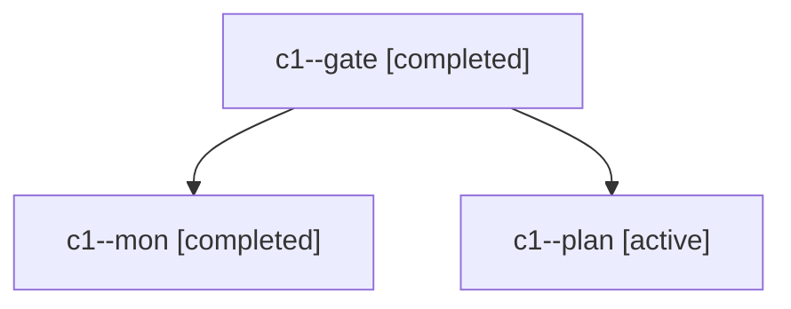

# Session: c1

[Agent Hoods](../README.md) / [bbugyi200](../users/bbugyi200/README.md) / [apollo](../users/bbugyi200/machines/apollo/README.md) / [c1](../users/bbugyi200/machines/apollo/hoods/c1/README.md) / c1

Owner: `bbugyi200.apollo` · Hood: `c1` · Members: 3

## Lineage

The diagram is an optional enhancement; the ordered table below contains the same lineage in accessible text.

| Role | Agent | State | Model / provider | Timing | Commits | Prompt | Chat |
|---|---|---|---|---|---:|---|---|
| gate | c1--gate | completed | opus / claude | 2026-11-02T04:41:02.701332+00:00 → 2026-11-02T04:41:24.589014+00:00 | 0 | — | [Chat](../agents/bbugyi200.apollo.c1--gate/chat.md) |
| mon | c1--mon | completed | opus / claude | 2026-11-02T04:41:22.380651+00:00 → 2026-11-02T04:43:28.875492+00:00 | 0 | — | [Chat](../agents/bbugyi200.apollo.c1--mon/chat.md) |
| plan | c1--plan | active | opus / claude | 2026-11-02T04:11:08.510934+00:00 | 0 | [Prompt](../agents/bbugyi200.apollo.c1--plan/prompt.md) | [Chat](../agents/bbugyi200.apollo.c1--plan/chat.md) |
