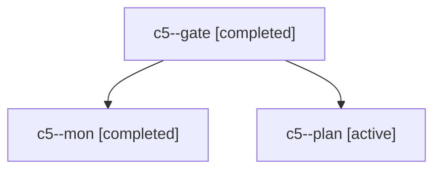

# Session: c5

[Agent Hoods](../README.md) / [bbugyi200](../users/bbugyi200/README.md) / [apollo](../users/bbugyi200/machines/apollo/README.md) / [c5](../users/bbugyi200/machines/apollo/hoods/c5/README.md) / c5

Owner: `bbugyi200.apollo` · Hood: `c5` · Members: 3

## Lineage

The diagram is an optional enhancement; the ordered table below contains the same lineage in accessible text.

| Role | Agent | State | Model / provider | Timing | Commits | Prompt | Chat |
|---|---|---|---|---|---:|---|---|
| gate | c5--gate | completed | opus / claude | 2026-11-02T02:42:05.463571+00:00 → 2026-11-02T02:42:22.068315+00:00 | 0 | — | [Chat](../agents/bbugyi200.apollo.c5--gate/chat.md) |
| mon | c5--mon | completed | opus / claude | 2026-11-02T02:42:20.099179+00:00 → 2026-11-02T02:45:50.316514+00:00 | 0 | — | [Chat](../agents/bbugyi200.apollo.c5--mon/chat.md) |
| plan | c5--plan | active | opus / claude | 2026-11-02T02:21:47.456696+00:00 | 0 | [Prompt](../agents/bbugyi200.apollo.c5--plan/prompt.md) | [Chat](../agents/bbugyi200.apollo.c5--plan/chat.md) |
