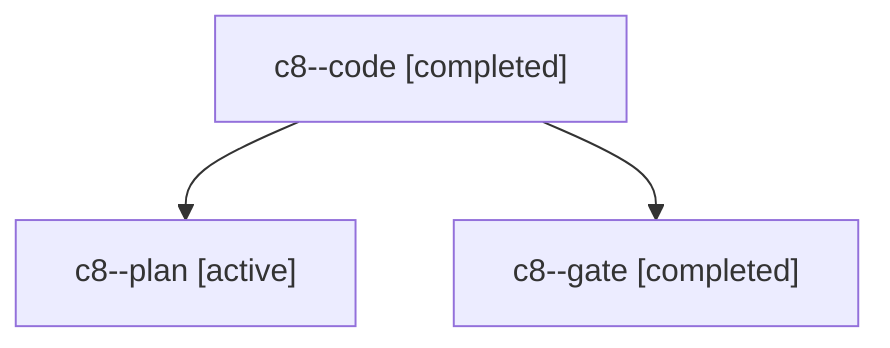

# Session: c8

[Agent Hoods](../README.md) / [bbugyi200](../users/bbugyi200/README.md) / [apollo](../users/bbugyi200/machines/apollo/README.md) / [c8](../users/bbugyi200/machines/apollo/hoods/c8/README.md) / c8

Owner: `bbugyi200.apollo` · Hood: `c8` · Members: 3

## Lineage

The diagram is an optional enhancement; the ordered table below contains the same lineage in accessible text.

| Role | Agent | State | Model / provider | Timing | Commits | Prompt | Chat |
|---|---|---|---|---|---:|---|---|
| code | c8--code | completed | muse-spark-1.3-contributor / muse | 2026-11-03T11:21:19.165637+00:00 → 2026-11-03T12:23:59.163447+00:00 | [1](../agents/bbugyi200.apollo.c8--code/README.md#commits) | [Prompt](../agents/bbugyi200.apollo.c8--code/prompt.md) | [Chat](../agents/bbugyi200.apollo.c8--code/chat.md) |
| plan | c8--plan | active | opus / claude | 2026-11-03T11:03:45.773151+00:00 | 0 | [Prompt](../agents/bbugyi200.apollo.c8--plan/prompt.md) | [Chat](../agents/bbugyi200.apollo.c8--plan/chat.md) |
| gate | c8--gate | completed | opus / claude | 2026-11-03T11:20:03.851174+00:00 → 2026-11-03T11:20:55.203930+00:00 | 0 | — | [Chat](../agents/bbugyi200.apollo.c8--gate/chat.md) |

## Commits

| Role | Repo | Commit | Subject | Committed |
|---|---|---|---|---|
| code | bob-cli | [`26d6410`](https://github.com/bobs-org/bob-cli/commit/26d6410fa64ea38bf7423c2001a81c97f0e1dbd4) | feat(gcal): read buffer reasons from description lines | 2026-11-03 07:23:48 EST |
