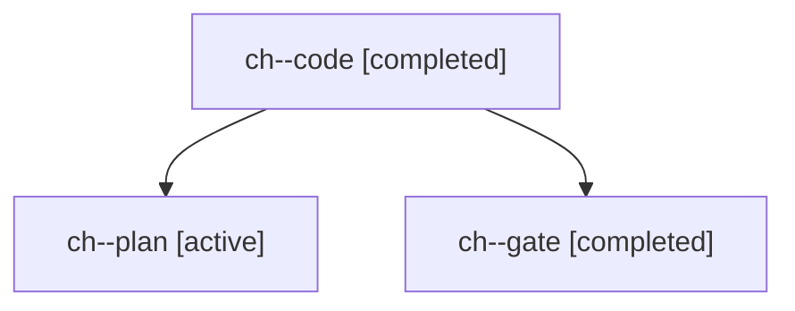

# Session: ch

[Agent Hoods](../README.md) / [bbugyi200](../users/bbugyi200/README.md) / [apollo](../users/bbugyi200/machines/apollo/README.md) / [ch](../users/bbugyi200/machines/apollo/hoods/ch/README.md) / ch

Owner: `bbugyi200.apollo` · Hood: `ch` · Members: 3

## Lineage

The diagram is an optional enhancement; the ordered table below contains the same lineage in accessible text.

| Role | Agent | State | Model / provider | Timing | Commits | Prompt | Chat |
|---|---|---|---|---|---:|---|---|
| code | ch--code | completed | gpt-6-luna / codex | 2026-11-04T22:43:35.943950+00:00 → 2026-11-04T23:21:48.467952+00:00 | [1](../agents/bbugyi200.apollo.ch--code/README.md#commits) | [Prompt](../agents/bbugyi200.apollo.ch--code/prompt.md) | [Chat](../agents/bbugyi200.apollo.ch--code/chat.md) |
| plan | ch--plan | active | opus / claude | 2026-11-04T22:30:33.603693+00:00 | 0 | [Prompt](../agents/bbugyi200.apollo.ch--plan/prompt.md) | [Chat](../agents/bbugyi200.apollo.ch--plan/chat.md) |
| gate | ch--gate | completed | opus / claude | 2026-11-04T22:42:26.175304+00:00 → 2026-11-04T22:43:08.498638+00:00 | 0 | — | [Chat](../agents/bbugyi200.apollo.ch--gate/chat.md) |

## Commits

| Role | Repo | Commit | Subject | Committed |
|---|---|---|---|---|
| code | bob-cli | [`1f91e85`](https://github.com/bobs-org/bob-cli/commit/1f91e85301bcc2e32b2deb508145295460a24f91) | docs(freshness): describe off-walk Alt+P footer hints | 2026-11-04 18:21:22 EST |
