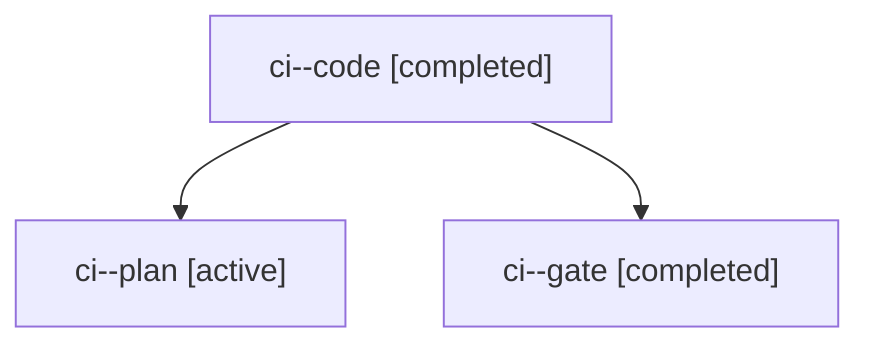

# Session: ci

[Agent Hoods](../README.md) / [bbugyi200](../users/bbugyi200/README.md) / [apollo](../users/bbugyi200/machines/apollo/README.md) / [ci](../users/bbugyi200/machines/apollo/hoods/ci/README.md) / ci

Owner: `bbugyi200.apollo` · Hood: `ci` · Members: 3

## Lineage

The diagram is an optional enhancement; the ordered table below contains the same lineage in accessible text.

| Role | Agent | State | Model / provider | Timing | Commits | Prompt | Chat |
|---|---|---|---|---|---:|---|---|
| code | ci--code | completed | muse-spark-1.3-contributor / muse | 2026-11-04T23:37:21.049728+00:00 → 2026-11-04T23:52:15.953087+00:00 | 0 | [Prompt](../agents/bbugyi200.apollo.ci--code/prompt.md) | [Chat](../agents/bbugyi200.apollo.ci--code/chat.md) |
| plan | ci--plan | active | opus / claude | 2026-11-04T23:25:50.896224+00:00 | 0 | [Prompt](../agents/bbugyi200.apollo.ci--plan/prompt.md) | [Chat](../agents/bbugyi200.apollo.ci--plan/chat.md) |
| gate | ci--gate | completed | opus / claude | 2026-11-04T23:35:47.928909+00:00 → 2026-11-04T23:36:49.676657+00:00 | 0 | — | [Chat](../agents/bbugyi200.apollo.ci--gate/chat.md) |

## Commits

| Role | Repo | Commit | Subject | Committed |
|---|---|---|---|---|
| — | bob-cli | [`c4e1d5e`](https://github.com/bobs-org/bob-cli/commit/c4e1d5e48e4683c8792fd14ae1a4eed69c8d6146) | feat(capture): normalize flat clipboard lists | 2026-07-17 16:29:15 EDT |
