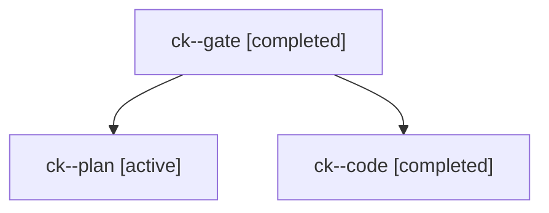

# Session: ck

[Agent Hoods](../README.md) / [bbugyi200](../users/bbugyi200/README.md) / [apollo](../users/bbugyi200/machines/apollo/README.md) / [ck](../users/bbugyi200/machines/apollo/hoods/ck/README.md) / ck

Owner: `bbugyi200.apollo` · Hood: `ck` · Members: 3

## Lineage

The diagram is an optional enhancement; the ordered table below contains the same lineage in accessible text.

| Role | Agent | State | Model / provider | Timing | Commits | Prompt | Chat |
|---|---|---|---|---|---:|---|---|
| gate | ck--gate | completed | opus / claude | 2026-11-05T13:56:44.207544+00:00 → 2026-11-05T13:57:35.712243+00:00 | 0 | — | [Chat](../agents/bbugyi200.apollo.ck--gate/chat.md) |
| plan | ck--plan | active | opus / claude | 2026-11-05T13:48:14.402967+00:00 | 0 | [Prompt](../agents/bbugyi200.apollo.ck--plan/prompt.md) | [Chat](../agents/bbugyi200.apollo.ck--plan/chat.md) |
| code | ck--code | completed | muse-spark-1.3-contributor / muse | 2026-11-05T13:58:03.239268+00:00 → 2026-11-05T14:28:55.647442+00:00 | [1](../agents/bbugyi200.apollo.ck--code/README.md#commits) | [Prompt](../agents/bbugyi200.apollo.ck--code/prompt.md) | [Chat](../agents/bbugyi200.apollo.ck--code/chat.md) |

## Commits

| Role | Repo | Commit | Subject | Committed |
|---|---|---|---|---|
| code | bob-cli | [`38df2d3`](https://github.com/bobs-org/bob-cli/commit/38df2d394c1768c0a5d15e7899661b73210f0e96) | docs(task-relations): prompt missing block IDs before merge preview | 2026-11-05 09:28:28 EST |
