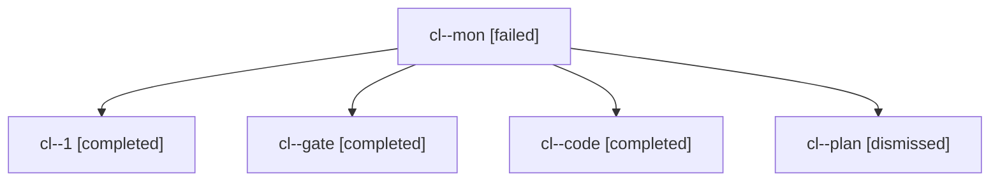

# Session: cl

[Agent Hoods](../README.md) / [bbugyi200](../users/bbugyi200/README.md) / [apollo](../users/bbugyi200/machines/apollo/README.md) / [cl](../users/bbugyi200/machines/apollo/hoods/cl/README.md) / cl

Owner: `bbugyi200.apollo` · Hood: `cl` · Members: 5

## Lineage

The diagram is an optional enhancement; the ordered table below contains the same lineage in accessible text.

| Role | Agent | State | Model / provider | Timing | Commits | Prompt | Chat |
|---|---|---|---|---|---:|---|---|
| mon | cl--mon | failed | gpt-6-luna / codex | 2026-11-05T15:10:06.320432+00:00 → 2026-11-05T15:33:01.183717+00:00 | 0 | — | [Chat](../agents/bbugyi200.apollo.cl--mon/chat.md) |
| 1 | cl--1 | completed | gpt-6-luna / codex | 2026-11-05T15:33:08.113587+00:00 → 2026-11-05T15:48:03.632030+00:00 | [1](../agents/bbugyi200.apollo.cl--1/README.md#commits) | [Prompt](../agents/bbugyi200.apollo.cl--1/prompt.md) | [Chat](../agents/bbugyi200.apollo.cl--1/chat.md) |
| gate | cl--gate | completed | opus / claude | 2026-11-05T14:04:56.237507+00:00 → 2026-11-05T14:05:31.195032+00:00 | 0 | — | [Chat](../agents/bbugyi200.apollo.cl--gate/chat.md) |
| code | cl--code | completed | gpt-6-luna / codex | 2026-11-05T14:05:57.436873+00:00 → 2026-11-05T15:11:43.801882+00:00 | 0 | [Prompt](../agents/bbugyi200.apollo.cl--code/prompt.md) | [Chat](../agents/bbugyi200.apollo.cl--code/chat.md) |
| plan | cl--plan | dismissed | opus / claude | 2026-11-05T08:51:14.449012 → 2026-11-05T09:03:59.730140 | 0 | [Prompt](../agents/bbugyi200.apollo.cl--plan/prompt.md) | [Chat](../agents/bbugyi200.apollo.cl--plan/chat.md) |

## Commits

| Role | Repo | Commit | Subject | Committed |
|---|---|---|---|---|
| 1 | — | `2e91d45` | feat(capture-pomodoros): report max\_task\_link\_count for x= close lists | 2026-11-05 10:47:15 EST |
