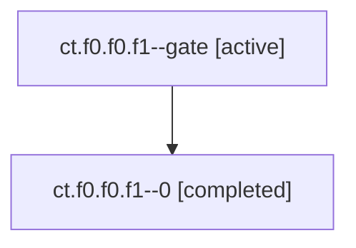

# Session: ct.f0.f0.f1

[Agent Hoods](../README.md) / [bbugyi200](../users/bbugyi200/README.md) / [apollo](../users/bbugyi200/machines/apollo/README.md) / [ct](../users/bbugyi200/machines/apollo/hoods/ct/README.md) / ct.f0.f0.f1

Owner: `bbugyi200.apollo` · Hood: `ct` · Members: 2

## Lineage

The diagram is an optional enhancement; the ordered table below contains the same lineage in accessible text.

| Role | Agent | State | Model / provider | Timing | Commits | Prompt | Chat |
|---|---|---|---|---|---:|---|---|
| gate | ct.f0.f0.f1--gate | active | opus / claude | 2026-11-07T09:44:59.443373+00:00 | 0 | — | — |
| 0 | ct.f0.f0.f1--0 | completed | opus / claude | 2026-11-07T09:11:20.016176+00:00 → 2026-11-07T09:45:02.845089+00:00 | [1](../agents/bbugyi200.apollo.ct.f0.f0.f1--0/README.md#commits) | [Prompt](../agents/bbugyi200.apollo.ct.f0.f0.f1--0/prompt.md) | [Chat](../agents/bbugyi200.apollo.ct.f0.f0.f1--0/chat.md) |

## Commits

| Role | Repo | Commit | Subject | Committed |
|---|---|---|---|---|
| 0 | bob-cli | [`ce81e2a`](https://github.com/bobs-org/bob-cli/commit/ce81e2a57535c99e132295d8f2601511c92aa112) | fix(gmail): add compose to a read-only grant and parse empty headers | 2026-11-07 04:44:30 EST |

## Neighbors

| Agent | Relation | State |
|---|---|---|
| [ct.f0.f0](bbugyi200.apollo.ct.f0.f0.md) (session · 5) | ancestor | completed 5 |
| [ct.f0.f0.f0](../agents/bbugyi200.apollo.ct.f0.f0.f0/README.md) | ct.f0.f0 hood | active |
