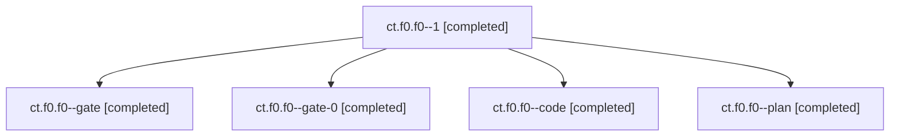

# Session: ct.f0.f0

[Agent Hoods](../README.md) / [bbugyi200](../users/bbugyi200/README.md) / [apollo](../users/bbugyi200/machines/apollo/README.md) / [ct](../users/bbugyi200/machines/apollo/hoods/ct/README.md) / ct.f0.f0

Owner: `bbugyi200.apollo` · Hood: `ct` · Members: 5

## Lineage

The diagram is an optional enhancement; the ordered table below contains the same lineage in accessible text.

| Role | Agent | State | Model / provider | Timing | Commits | Prompt | Chat |
|---|---|---|---|---|---:|---|---|
| 1 | ct.f0.f0--1 | completed | muse-spark-1.3-contributor / muse | 2026-11-07T08:57:43.565254+00:00 → 2026-11-07T09:00:37.497353+00:00 | 0 | [Prompt](../agents/bbugyi200.apollo.ct.f0.f0--1/prompt.md) | [Chat](../agents/bbugyi200.apollo.ct.f0.f0--1/chat.md) |
| gate | ct.f0.f0--gate | completed | opus / claude | 2026-11-07T08:28:54.341529+00:00 → 2026-11-07T08:29:16.987146+00:00 | 0 | — | [Chat](../agents/bbugyi200.apollo.ct.f0.f0--gate/chat.md) |
| gate-0 | ct.f0.f0--gate-0 | completed | muse-spark-1.3-contributor / muse | 2026-11-07T08:56:37.999314+00:00 → 2026-11-07T08:56:58.819851+00:00 | 0 | — | [Chat](../agents/bbugyi200.apollo.ct.f0.f0--gate-0/chat.md) |
| code | ct.f0.f0--code | completed | muse-spark-1.3-contributor / muse | 2026-11-07T08:29:36.577189+00:00 → 2026-11-07T08:36:18.677010+00:00 | 0 | [Prompt](../agents/bbugyi200.apollo.ct.f0.f0--code/prompt.md) | [Chat](../agents/bbugyi200.apollo.ct.f0.f0--code/chat.md) |
| plan | ct.f0.f0--plan | completed | opus / claude | 2026-11-06T21:23:00.179903+00:00 → 2026-11-06T21:38:36.378266+00:00 | 0 | [Prompt](../agents/bbugyi200.apollo.ct.f0.f0--plan/prompt.md) | [Chat](../agents/bbugyi200.apollo.ct.f0.f0--plan/chat.md) |

## Neighbors

| Agent | Relation | State |
|---|---|---|
| [ct.f0.f0.f0](../agents/bbugyi200.apollo.ct.f0.f0.f0/README.md) | descendant | dismissed |
| [ct.f0.f0.f1](bbugyi200.apollo.ct.f0.f0.f1.md) (session · 3) | descendant | completed 3 |
