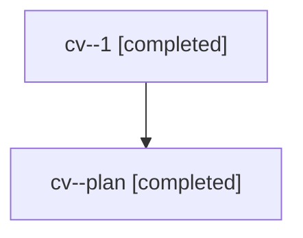

# Session: cv

[Agent Hoods](../README.md) / [bbugyi200](../users/bbugyi200/README.md) / [apollo](../users/bbugyi200/machines/apollo/README.md) / [cv](../users/bbugyi200/machines/apollo/hoods/cv/README.md) / cv

Owner: `bbugyi200.apollo` · Hood: `cv` · Members: 2

## Lineage



The diagram is an optional enhancement; the ordered table below contains the same lineage in accessible text.

| Role | Agent | State | Model / provider | Timing | Commits | Prompt | Chat |
|---|---|---|---|---|---:|---|---|
| <a id="member-1"></a>1 | cv--1 | completed | gpt-6-astra / codex | 2026-11-07T18:33:54.719607+00:00 → 2026-11-07T18:45:09.763137+00:00 | 0 | — | [Chat](../agents/bbugyi200.apollo.cv--1/chat.md) |
| <a id="member-plan"></a>plan | cv--plan | completed | opus / claude | 2026-11-07T18:18:26.381322+00:00 → 2026-11-07T18:45:09.763137+00:00 | 0 | [Prompt](../agents/bbugyi200.apollo.cv--plan/prompt.md) | [Chat](../agents/bbugyi200.apollo.cv--plan/chat.md) |

## Variables

| Role | Variable | Value |
|---|---|---|
| 1 | `artifacts` | \[{kind: file, label: Gmail sync infographic — built-in imagegen prompt, path: /home/bryan/.sase/artifacts/agents/gh\_bobs-org\_\_bob-cli/20261107133346/infographic\_prompt-8b9ee7dcb59b.txt, ref: file:exp… |

#### artifacts

**Role:** `1`

```yaml
- kind: file
  label: Gmail sync infographic — built-in imagegen prompt
  path: /home/bryan/.sase/artifacts/agents/gh_bobs-org__bob-cli/20261107133346/infographic_prompt-8b9ee7dcb59b.txt
  ref: file:explicit:3e6f462b472b63be3ad8694c
  source_path: /home/bryan/.local/state/sase/workspaces/bobs-org/bob-cli/bob-cli_10/.build/gmail_sync_review/infographic_prompt.txt
- kind: markdown
  label: Gmail thread and Obsidian note sync — verified report
  path: /home/bryan/.sase/artifacts/agents/gh_bobs-org__bob-cli/20261107133346/gmail_thread_note_sync-f630d3f6b640.md
  ref: file:explicit:6a1f0aaa5feda226cbb456c7
  source_path: /home/bryan/.local/state/sase/workspaces/bobs-org/bob-cli/bob-cli_10/sase/repos/research/202611/gmail_thread_note_sync/gmail_thread_note_sync.md
- kind: image
  label: Gmail sync — generated infographic
  path: /home/bryan/.sase/artifacts/agents/gh_bobs-org__bob-cli/20261107133346/gmail_thread_note_sync_infographic-8e2f6810727d.png
  ref: file:explicit:deff7e2cd16e1f812401f222
  source_path: /home/bryan/.local/state/sase/workspaces/bobs-org/bob-cli/bob-cli_10/sase/repos/research/202611/gmail_thread_note_sync/gmail_thread_note_sync_infographic.png
```

Values are truncated for display; see each member's agent meta.json for the full values.
