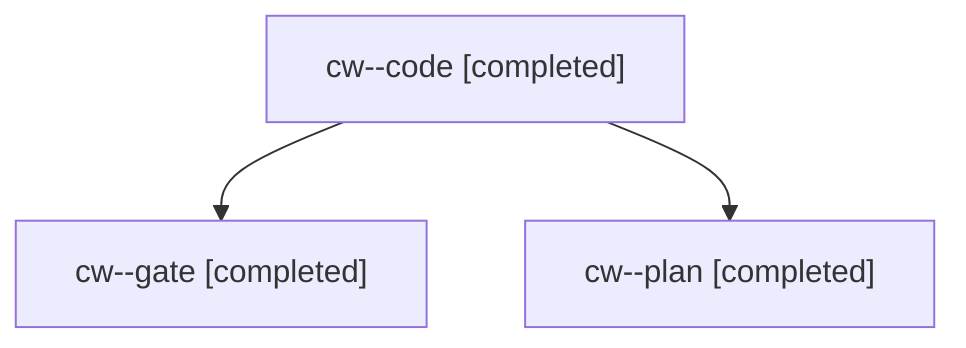

# Session: cw

[Agent Hoods](../README.md) / [bbugyi200](../users/bbugyi200/README.md) / [apollo](../users/bbugyi200/machines/apollo/README.md) / [cw](../users/bbugyi200/machines/apollo/hoods/cw/README.md) / cw

Owner: `bbugyi200.apollo` · Hood: `cw` · Members: 3

## Lineage

The diagram is an optional enhancement; the ordered table below contains the same lineage in accessible text.

| Role | Agent | State | Model / provider | Timing | Commits | Prompt | Chat |
|---|---|---|---|---|---:|---|---|
| code | cw--code | completed | opus / claude | 2026-11-07T19:08:10.160723+00:00 → 2026-11-07T19:44:51.811334+00:00 | [1](../agents/bbugyi200.apollo.cw--code/README.md#commits) | [Prompt](../agents/bbugyi200.apollo.cw--code/prompt.md) | [Chat](../agents/bbugyi200.apollo.cw--code/chat.md) |
| gate | cw--gate | completed | opus / claude | 2026-11-07T19:07:17.450018+00:00 → 2026-11-07T19:07:48.568196+00:00 | 0 | — | [Chat](../agents/bbugyi200.apollo.cw--gate/chat.md) |
| plan | cw--plan | completed | opus / claude | 2026-11-07T18:52:18.284454+00:00 → 2026-11-07T19:00:53.182669+00:00 | 0 | [Prompt](../agents/bbugyi200.apollo.cw--plan/prompt.md) | [Chat](../agents/bbugyi200.apollo.cw--plan/chat.md) |

## Commits

| Role | Repo | Commit | Subject | Committed |
|---|---|---|---|---|
| code | bob-cli | [`30841c2`](https://github.com/bobs-org/bob-cli/commit/30841c2912519dace8d8bd75d2909f6f044a99e1) | fix(task-status): cap a grouped Tasks section's trailing gap at one blank line | 2026-11-07 14:44:40 EST |
