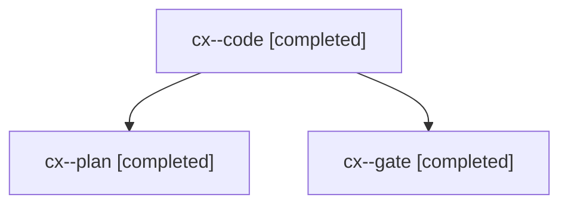

# Session: cx

[Agent Hoods](../README.md) / [bbugyi200](../users/bbugyi200/README.md) / [apollo](../users/bbugyi200/machines/apollo/README.md) / [cx](../users/bbugyi200/machines/apollo/hoods/cx/README.md) / cx

Owner: `bbugyi200.apollo` · Hood: `cx` · Members: 3

## Lineage

The diagram is an optional enhancement; the ordered table below contains the same lineage in accessible text.

| Role | Agent | State | Model / provider | Timing | Commits | Prompt | Chat |
|---|---|---|---|---|---:|---|---|
| code | cx--code | completed | opus / claude | 2026-11-07T19:03:34.062385+00:00 → 2026-11-07T19:37:39.762904+00:00 | [1](../agents/bbugyi200.apollo.cx--code/README.md#commits) | [Prompt](../agents/bbugyi200.apollo.cx--code/prompt.md) | [Chat](../agents/bbugyi200.apollo.cx--code/chat.md) |
| plan | cx--plan | completed | opus / claude | 2026-11-07T18:52:55.826455+00:00 → 2026-11-07T19:00:55.305319+00:00 | 0 | [Prompt](../agents/bbugyi200.apollo.cx--plan/prompt.md) | [Chat](../agents/bbugyi200.apollo.cx--plan/chat.md) |
| gate | cx--gate | completed | opus / claude | 2026-11-07T19:02:36.492479+00:00 → 2026-11-07T19:03:16.928037+00:00 | 0 | — | [Chat](../agents/bbugyi200.apollo.cx--gate/chat.md) |

## Commits

| Role | Repo | Commit | Subject | Committed |
|---|---|---|---|---|
| code | bob-cli | [`181efa4`](https://github.com/bobs-org/bob-cli/commit/181efa41ee75afc96dc4fb33602fe8d82b6a2cea) | fix(vault-sync): union same-point Markdown insertions instead of quarantining | 2026-11-07 14:36:50 EST |
