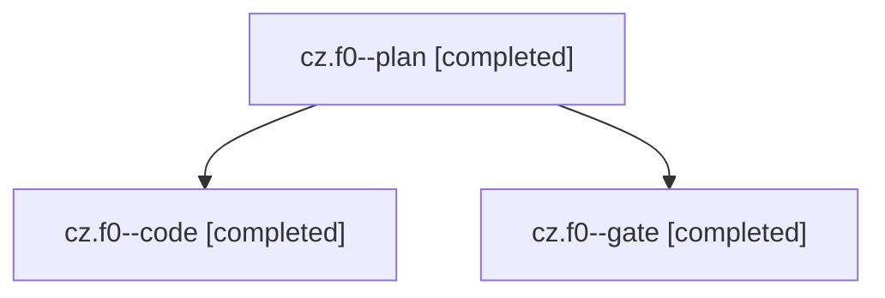

# Session: cz.f0

[Agent Hoods](../README.md) / [bbugyi200](../users/bbugyi200/README.md) / [apollo](../users/bbugyi200/machines/apollo/README.md) / [cz](../users/bbugyi200/machines/apollo/hoods/cz/README.md) / cz.f0

Owner: `bbugyi200.apollo` · Hood: `cz` · Members: 3

## Lineage

The diagram is an optional enhancement; the ordered table below contains the same lineage in accessible text.

| Role | Agent | State | Model / provider | Timing | Commits | Prompt | Chat |
|---|---|---|---|---|---:|---|---|
| plan | cz.f0--plan | completed | opus / claude | 2026-11-08T12:54:00.754283+00:00 → 2026-11-08T13:06:55.612368+00:00 | 0 | [Prompt](../agents/bbugyi200.apollo.cz.f0--plan/prompt.md) | [Chat](../agents/bbugyi200.apollo.cz.f0--plan/chat.md) |
| code | cz.f0--code | completed | grok-4.6 / grok | 2026-11-08T13:24:15.548254+00:00 → 2026-11-08T14:03:31.668091+00:00 | [1](../agents/bbugyi200.apollo.cz.f0--code/README.md#commits) | [Prompt](../agents/bbugyi200.apollo.cz.f0--code/prompt.md) | [Chat](../agents/bbugyi200.apollo.cz.f0--code/chat.md) |
| gate | cz.f0--gate | completed | opus / claude | 2026-11-08T13:23:21.719067+00:00 → 2026-11-08T13:23:58.463065+00:00 | 0 | — | [Chat](../agents/bbugyi200.apollo.cz.f0--gate/chat.md) |

## Commits

| Role | Repo | Commit | Subject | Committed |
|---|---|---|---|---|
| code | bob-cli | [`063f9c2`](https://github.com/bobs-org/bob-cli/commit/063f9c2374ae1a5549db450f778e84ac42a77305) | fix(gmail): list sync and RFC thread ids through gog threads.list | 2026-11-08 09:03:20 EST |

## Neighbors

| Agent | Relation | State |
|---|---|---|
| [cz](bbugyi200.apollo.cz.md) (session · 9) | ancestor | completed 7, failed 2 |
