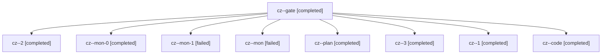

# Session: cz

[Agent Hoods](../README.md) / [bbugyi200](../users/bbugyi200/README.md) / [apollo](../users/bbugyi200/machines/apollo/README.md) / [cz](../users/bbugyi200/machines/apollo/hoods/cz/README.md) / cz

Owner: `bbugyi200.apollo` · Hood: `cz` · Members: 9

## Lineage

The diagram is an optional enhancement; the ordered table below contains the same lineage in accessible text.

| Role | Agent | State | Model / provider | Timing | Commits | Prompt | Chat |
|---|---|---|---|---|---:|---|---|
| gate | cz--gate | completed | opus / claude | 2026-11-08T11:39:23.289116+00:00 → 2026-11-08T11:39:59.087948+00:00 | 0 | — | [Chat](../agents/bbugyi200.apollo.cz--gate/chat.md) |
| 2 | cz--2 | completed | gpt-6-luna / codex | 2026-11-08T12:28:23.069029+00:00 → 2026-11-08T12:35:14.641186+00:00 | 0 | [Prompt](../agents/bbugyi200.apollo.cz--2/prompt.md) | [Chat](../agents/bbugyi200.apollo.cz--2/chat.md) |
| mon-0 | cz--mon-0 | completed | gpt-6-luna / codex | 2026-11-08T12:16:41.218083+00:00 → 2026-11-08T12:28:18.905776+00:00 | 0 | — | [Chat](../agents/bbugyi200.apollo.cz--mon-0/chat.md) |
| mon-1 | cz--mon-1 | failed | gpt-6-luna / codex | 2026-11-08T12:34:07.670761+00:00 → 2026-11-08T12:36:53.317153+00:00 | 0 | — | [Chat](../agents/bbugyi200.apollo.cz--mon-1/chat.md) |
| mon | cz--mon | failed | gpt-6-luna / codex | 2026-11-08T12:07:25.270130+00:00 → 2026-11-08T12:12:53.917359+00:00 | 0 | — | [Chat](../agents/bbugyi200.apollo.cz--mon/chat.md) |
| plan | cz--plan | completed | opus / claude | 2026-11-08T11:27:15.479175+00:00 → 2026-11-08T11:38:49.878116+00:00 | 0 | [Prompt](../agents/bbugyi200.apollo.cz--plan/prompt.md) | [Chat](../agents/bbugyi200.apollo.cz--plan/chat.md) |
| 3 | cz--3 | completed | gpt-6-luna / codex | 2026-11-08T12:36:53.285209+00:00 → 2026-11-08T12:41:00.924801+00:00 | [1](../agents/bbugyi200.apollo.cz--3/README.md#commits) | [Prompt](../agents/bbugyi200.apollo.cz--3/prompt.md) | [Chat](../agents/bbugyi200.apollo.cz--3/chat.md) |
| 1 | cz--1 | completed | gpt-6-luna / codex | 2026-11-08T12:12:53.762972+00:00 → 2026-11-08T12:17:31.487312+00:00 | 0 | [Prompt](../agents/bbugyi200.apollo.cz--1/prompt.md) | [Chat](../agents/bbugyi200.apollo.cz--1/chat.md) |
| code | cz--code | completed | gpt-6-luna / codex | 2026-11-08T11:40:18.886781+00:00 → 2026-11-08T12:08:42.153862+00:00 | 0 | [Prompt](../agents/bbugyi200.apollo.cz--code/prompt.md) | [Chat](../agents/bbugyi200.apollo.cz--code/chat.md) |

## Commits

| Role | Repo | Commit | Subject | Committed |
|---|---|---|---|---|
| 3 | bob-cli | [`809c0fc`](https://github.com/bobs-org/bob-cli/commit/809c0fc728ecb88ad46441ecb387e704806da7b5) | feat(google): configure gog executable and config root | 2026-11-08 07:39:05 EST |
