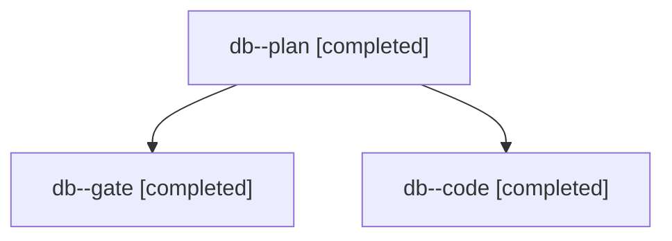

# Session: db

[Agent Hoods](../README.md) / [bbugyi200](../users/bbugyi200/README.md) / [apollo](../users/bbugyi200/machines/apollo/README.md) / [db](../users/bbugyi200/machines/apollo/hoods/db/README.md) / db

Owner: `bbugyi200.apollo` · Hood: `db` · Members: 3

## Lineage

The diagram is an optional enhancement; the ordered table below contains the same lineage in accessible text.

| Role | Agent | State | Model / provider | Timing | Commits | Prompt | Chat |
|---|---|---|---|---|---:|---|---|
| plan | db--plan | completed | claude-fable-5 / claude | 2026-11-11T19:06:43.476265+00:00 → 2026-11-11T19:18:32.662853+00:00 | 0 | [Prompt](../agents/bbugyi200.apollo.db--plan/prompt.md) | [Chat](../agents/bbugyi200.apollo.db--plan/chat.md) |
| gate | db--gate | completed | claude-fable-5 / claude | 2026-11-11T19:18:56.193669+00:00 → 2026-11-11T19:19:37.525908+00:00 | 0 | — | [Chat](../agents/bbugyi200.apollo.db--gate/chat.md) |
| code | db--code | completed | gpt-6-luna / codex | 2026-11-11T19:19:54.898028+00:00 → 2026-11-11T19:22:49.012374+00:00 | [1](../agents/bbugyi200.apollo.db--code/README.md#commits) | [Prompt](../agents/bbugyi200.apollo.db--code/prompt.md) | [Chat](../agents/bbugyi200.apollo.db--code/chat.md) |

## Commits

| Role | Repo | Commit | Subject | Committed |
|---|---|---|---|---|
| code | bob-cli | [`1a9b682`](https://github.com/bobs-org/bob-cli/commit/1a9b68289f65f57d0b4a1bc3d9f955f82ae0291a) | fix(git): restore check-ignore probes | 2026-11-11 14:22:38 EST |
