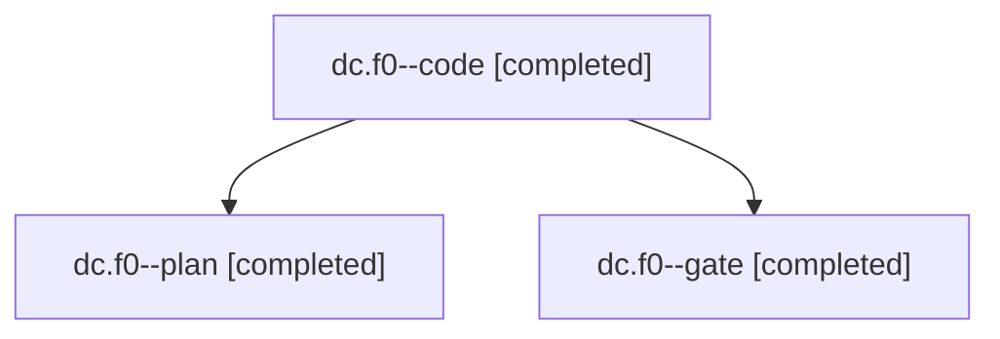

# Session: dc.f0

[Agent Hoods](../README.md) / [bbugyi200](../users/bbugyi200/README.md) / [apollo](../users/bbugyi200/machines/apollo/README.md) / [dc](../users/bbugyi200/machines/apollo/hoods/dc/README.md) / dc.f0

Owner: `bbugyi200.apollo` · Hood: `dc` · Members: 3

## Lineage

The diagram is an optional enhancement; the ordered table below contains the same lineage in accessible text.

| Role | Agent | State | Model / provider | Timing | Commits | Prompt | Chat |
|---|---|---|---|---|---:|---|---|
| code | dc.f0--code | completed | muse-spark-1.3-contributor / muse | 2026-11-11T20:36:19.969074+00:00 → 2026-11-11T21:24:29.043802+00:00 | [1](../agents/bbugyi200.apollo.dc.f0--code/README.md#commits) | [Prompt](../agents/bbugyi200.apollo.dc.f0--code/prompt.md) | [Chat](../agents/bbugyi200.apollo.dc.f0--code/chat.md) |
| plan | dc.f0--plan | completed | claude-fable-5 / claude | 2026-11-11T20:23:03.678352+00:00 → 2026-11-11T20:34:15.751387+00:00 | 0 | [Prompt](../agents/bbugyi200.apollo.dc.f0--plan/prompt.md) | [Chat](../agents/bbugyi200.apollo.dc.f0--plan/chat.md) |
| gate | dc.f0--gate | completed | claude-fable-5 / claude | 2026-11-11T20:35:07.036044+00:00 → 2026-11-11T20:36:00.927502+00:00 | 0 | — | [Chat](../agents/bbugyi200.apollo.dc.f0--gate/chat.md) |

## Commits

| Role | Repo | Commit | Subject | Committed |
|---|---|---|---|---|
| code | bob-cli | [`6a88d81`](https://github.com/bobs-org/bob-cli/commit/6a88d8106aa7d4eb57858e67a1673f6c5f2e4e8a) | feat(plugins)!: deploy enclosing checkout and fetch on pull failure | 2026-11-11 16:24:17 EST |

## Neighbors

| Agent | Relation | State |
|---|---|---|
| [dc](bbugyi200.apollo.dc.md) (session · 3) | ancestor | completed 3 |
