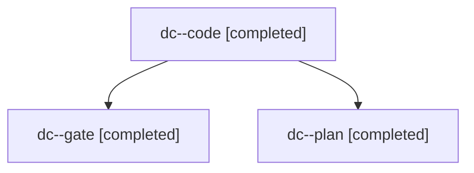

# Session: dc

[Agent Hoods](../README.md) / [bbugyi200](../users/bbugyi200/README.md) / [apollo](../users/bbugyi200/machines/apollo/README.md) / [dc](../users/bbugyi200/machines/apollo/hoods/dc/README.md) / dc

Owner: `bbugyi200.apollo` · Hood: `dc` · Members: 3

## Lineage

The diagram is an optional enhancement; the ordered table below contains the same lineage in accessible text.

| Role | Agent | State | Model / provider | Timing | Commits | Prompt | Chat |
|---|---|---|---|---|---:|---|---|
| code | dc--code | completed | grok-4.6 / grok | 2026-11-11T19:50:30.887030+00:00 → 2026-11-11T20:22:43.043876+00:00 | [1](../agents/bbugyi200.apollo.dc--code/README.md#commits) | [Prompt](../agents/bbugyi200.apollo.dc--code/prompt.md) | [Chat](../agents/bbugyi200.apollo.dc--code/chat.md) |
| gate | dc--gate | completed | claude-fable-5 / claude | 2026-11-11T19:49:31.847688+00:00 → 2026-11-11T19:50:13.241513+00:00 | 0 | — | [Chat](../agents/bbugyi200.apollo.dc--gate/chat.md) |
| plan | dc--plan | completed | claude-fable-5 / claude | 2026-11-11T19:35:20.631888+00:00 → 2026-11-11T19:47:12.982548+00:00 | 0 | [Prompt](../agents/bbugyi200.apollo.dc--plan/prompt.md) | [Chat](../agents/bbugyi200.apollo.dc--plan/chat.md) |

## Commits

| Role | Repo | Commit | Subject | Committed |
|---|---|---|---|---|
| code | bob-cli | [`8134d17`](https://github.com/bobs-org/bob-cli/commit/8134d17310869db7afddde27e0f5df099d593c46) | docs(task-tag-marks): document #prj target and #hide eye-off marks | 2026-11-11 15:22:18 EST |

## Neighbors

| Agent | Relation | State |
|---|---|---|
| [dc.f0](../agents/bbugyi200.apollo.dc.f0/README.md) | descendant | active |
