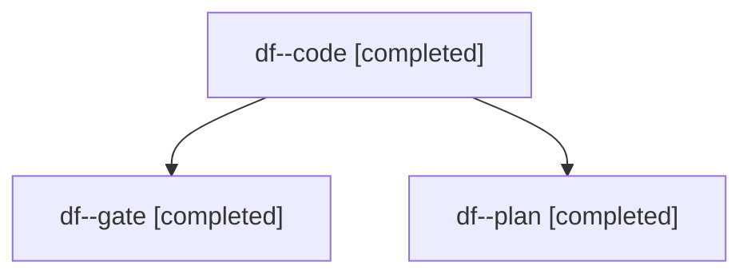

# Session: df

[Agent Hoods](../README.md) / [bbugyi200](../users/bbugyi200/README.md) / [apollo](../users/bbugyi200/machines/apollo/README.md) / [df](../users/bbugyi200/machines/apollo/hoods/df/README.md) / df

Owner: `bbugyi200.apollo` · Hood: `df` · Members: 3

## Lineage

The diagram is an optional enhancement; the ordered table below contains the same lineage in accessible text.

| Role | Agent | State | Model / provider | Timing | Commits | Prompt | Chat |
|---|---|---|---|---|---:|---|---|
| code | df--code | completed | muse-spark-1.3-contributor / muse | 2026-11-12T11:22:26.744344+00:00 → 2026-11-12T11:35:56.184316+00:00 | 0 | [Prompt](../agents/bbugyi200.apollo.df--code/prompt.md) | [Chat](../agents/bbugyi200.apollo.df--code/chat.md) |
| gate | df--gate | completed | claude-fable-5 / claude | 2026-11-12T11:21:27.725624+00:00 → 2026-11-12T11:22:02.900554+00:00 | 0 | — | [Chat](../agents/bbugyi200.apollo.df--gate/chat.md) |
| plan | df--plan | completed | claude-fable-5 / claude | 2026-11-12T11:11:18.359907+00:00 → 2026-11-12T11:21:13.541687+00:00 | 0 | [Prompt](../agents/bbugyi200.apollo.df--plan/prompt.md) | [Chat](../agents/bbugyi200.apollo.df--plan/chat.md) |
