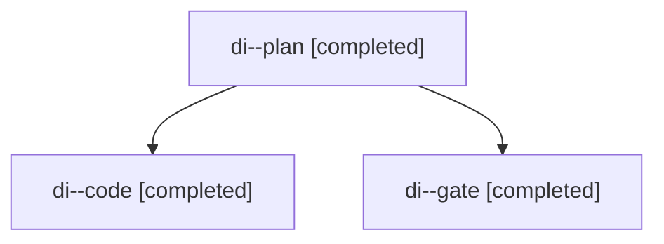

# Session: di

[Agent Hoods](../README.md) / [bbugyi200](../users/bbugyi200/README.md) / [apollo](../users/bbugyi200/machines/apollo/README.md) / [di](../users/bbugyi200/machines/apollo/hoods/di/README.md) / di

Owner: `bbugyi200.apollo` · Hood: `di` · Members: 3

## Lineage

The diagram is an optional enhancement; the ordered table below contains the same lineage in accessible text.

| Role | Agent | State | Model / provider | Timing | Commits | Prompt | Chat |
|---|---|---|---|---|---:|---|---|
| plan | di--plan | completed | opus / claude | 2026-11-12T13:00:00.362719+00:00 → 2026-11-12T13:05:26.534316+00:00 | 0 | [Prompt](../agents/bbugyi200.apollo.di--plan/prompt.md) | [Chat](../agents/bbugyi200.apollo.di--plan/chat.md) |
| code | di--code | completed | gpt-6-luna / codex | 2026-11-12T13:26:33.431033+00:00 → 2026-11-12T13:34:08.386675+00:00 | 0 | [Prompt](../agents/bbugyi200.apollo.di--code/prompt.md) | [Chat](../agents/bbugyi200.apollo.di--code/chat.md) |
| gate | di--gate | completed | opus / claude | 2026-11-12T13:25:34.262732+00:00 → 2026-11-12T13:26:07.285892+00:00 | 0 | — | [Chat](../agents/bbugyi200.apollo.di--gate/chat.md) |
