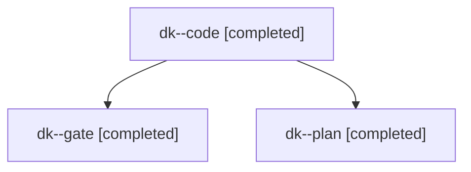

# Session: dk

[Agent Hoods](../README.md) / [bbugyi200](../users/bbugyi200/README.md) / [apollo](../users/bbugyi200/machines/apollo/README.md) / [dk](../users/bbugyi200/machines/apollo/hoods/dk/README.md) / dk

Owner: `bbugyi200.apollo` · Hood: `dk` · Members: 3

## Lineage

The diagram is an optional enhancement; the ordered table below contains the same lineage in accessible text.

| Role | Agent | State | Model / provider | Timing | Commits | Prompt | Chat |
|---|---|---|---|---|---:|---|---|
| code | dk--code | completed | muse-spark-1.3-contributor / muse | 2026-11-12T14:46:35.856995+00:00 → 2026-11-12T15:09:47.556786+00:00 | [1](../agents/bbugyi200.apollo.dk--code/README.md#commits) | [Prompt](../agents/bbugyi200.apollo.dk--code/prompt.md) | [Chat](../agents/bbugyi200.apollo.dk--code/chat.md) |
| gate | dk--gate | completed | claude-fable-5 / claude | 2026-11-12T14:45:15.313687+00:00 → 2026-11-12T14:46:05.567681+00:00 | 0 | — | [Chat](../agents/bbugyi200.apollo.dk--gate/chat.md) |
| plan | dk--plan | completed | claude-fable-5 / claude | 2026-11-12T14:30:16.854136+00:00 → 2026-11-12T14:44:24.133221+00:00 | 0 | [Prompt](../agents/bbugyi200.apollo.dk--plan/prompt.md) | [Chat](../agents/bbugyi200.apollo.dk--plan/chat.md) |

## Commits

| Role | Repo | Commit | Subject | Committed |
|---|---|---|---|---|
| code | bob-cli | [`94897d5`](https://github.com/bobs-org/bob-cli/commit/94897d50458320105d108db685bd155702164005) | feat(gmail): add Gmail Task glossary term and Cmd+Enter open docs | 2026-11-12 10:09:14 EST |
