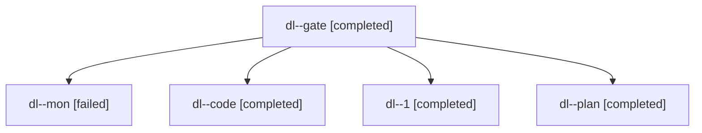

# Session: dl

[Agent Hoods](../README.md) / [bbugyi200](../users/bbugyi200/README.md) / [apollo](../users/bbugyi200/machines/apollo/README.md) / [dl](../users/bbugyi200/machines/apollo/hoods/dl/README.md) / dl

Owner: `bbugyi200.apollo` · Hood: `dl` · Members: 5

## Lineage

The diagram is an optional enhancement; the ordered table below contains the same lineage in accessible text.

| Role | Agent | State | Model / provider | Timing | Commits | Prompt | Chat |
|---|---|---|---|---|---:|---|---|
| gate | dl--gate | completed | claude-fable-5 / claude | 2026-11-12T14:58:19.557989+00:00 → 2026-11-12T14:59:18.450568+00:00 | 0 | — | [Chat](../agents/bbugyi200.apollo.dl--gate/chat.md) |
| mon | dl--mon | failed | gpt-6-luna / codex | 2026-11-12T15:18:14.236873+00:00 → 2026-11-12T15:22:00.167741+00:00 | 0 | — | [Chat](../agents/bbugyi200.apollo.dl--mon/chat.md) |
| code | dl--code | completed | gpt-6-luna / codex | 2026-11-12T15:00:03.883891+00:00 → 2026-11-12T15:19:08.688364+00:00 | 0 | [Prompt](../agents/bbugyi200.apollo.dl--code/prompt.md) | [Chat](../agents/bbugyi200.apollo.dl--code/chat.md) |
| 1 | dl--1 | completed | gpt-6-luna / codex | 2026-11-12T15:22:26.192230+00:00 → 2026-11-12T15:44:34.754855+00:00 | 0 | [Prompt](../agents/bbugyi200.apollo.dl--1/prompt.md) | [Chat](../agents/bbugyi200.apollo.dl--1/chat.md) |
| plan | dl--plan | completed | claude-fable-5 / claude | 2026-11-12T14:40:13.541881+00:00 → 2026-11-12T14:51:14.129853+00:00 | 0 | [Prompt](../agents/bbugyi200.apollo.dl--plan/prompt.md) | [Chat](../agents/bbugyi200.apollo.dl--plan/chat.md) |
