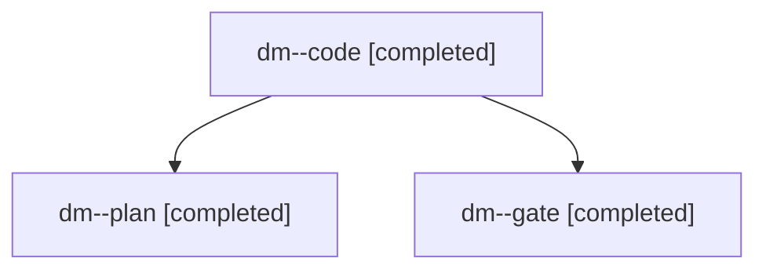

# Session: dm

[Agent Hoods](../README.md) / [bbugyi200](../users/bbugyi200/README.md) / [apollo](../users/bbugyi200/machines/apollo/README.md) / [dm](../users/bbugyi200/machines/apollo/hoods/dm/README.md) / dm

Owner: `bbugyi200.apollo` · Hood: `dm` · Members: 3

## Lineage

The diagram is an optional enhancement; the ordered table below contains the same lineage in accessible text.

| Role | Agent | State | Model / provider | Timing | Commits | Prompt | Chat |
|---|---|---|---|---|---:|---|---|
| code | dm--code | completed | muse-spark-1.3-contributor / muse | 2026-11-12T15:38:18.021578+00:00 → 2026-11-12T15:58:50.962890+00:00 | 0 | [Prompt](../agents/bbugyi200.apollo.dm--code/prompt.md) | [Chat](../agents/bbugyi200.apollo.dm--code/chat.md) |
| plan | dm--plan | completed | opus / claude | 2026-11-12T15:29:47.801500+00:00 → 2026-11-12T15:36:12.129640+00:00 | 0 | [Prompt](../agents/bbugyi200.apollo.dm--plan/prompt.md) | [Chat](../agents/bbugyi200.apollo.dm--plan/chat.md) |
| gate | dm--gate | completed | opus / claude | 2026-11-12T15:36:45.556431+00:00 → 2026-11-12T15:37:48.089666+00:00 | 0 | — | [Chat](../agents/bbugyi200.apollo.dm--gate/chat.md) |
