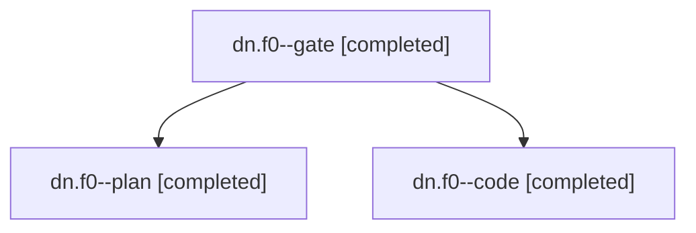

# Session: dn.f0

[Agent Hoods](../README.md) / [bbugyi200](../users/bbugyi200/README.md) / [apollo](../users/bbugyi200/machines/apollo/README.md) / [dn](../users/bbugyi200/machines/apollo/hoods/dn/README.md) / dn.f0

Owner: `bbugyi200.apollo` · Hood: `dn` · Members: 3

## Lineage

The diagram is an optional enhancement; the ordered table below contains the same lineage in accessible text.

| Role | Agent | State | Model / provider | Timing | Commits | Prompt | Chat |
|---|---|---|---|---|---:|---|---|
| gate | dn.f0--gate | completed | claude-fable-5 / claude | 2026-11-12T17:04:56.328053+00:00 → 2026-11-12T17:05:56.537003+00:00 | 0 | — | [Chat](../agents/bbugyi200.apollo.dn.f0--gate/chat.md) |
| plan | dn.f0--plan | completed | claude-fable-5 / claude | 2026-11-12T16:46:48.360622+00:00 → 2026-11-12T17:03:33.992941+00:00 | 0 | [Prompt](../agents/bbugyi200.apollo.dn.f0--plan/prompt.md) | [Chat](../agents/bbugyi200.apollo.dn.f0--plan/chat.md) |
| code | dn.f0--code | completed | gpt-6-luna / codex | 2026-11-12T17:06:27.959819+00:00 → 2026-11-12T18:01:33.394595+00:00 | [1](../agents/bbugyi200.apollo.dn.f0--code/README.md#commits) | [Prompt](../agents/bbugyi200.apollo.dn.f0--code/prompt.md) | [Chat](../agents/bbugyi200.apollo.dn.f0--code/chat.md) |

## Commits

| Role | Repo | Commit | Subject | Committed |
|---|---|---|---|---|
| code | bob-cli | [`8456b73`](https://github.com/bobs-org/bob-cli/commit/8456b7368d2500217c616615a94ff78735a65a01) | feat(gcal): close Bob-filed rows on past-day sync | 2026-11-12 13:00:59 EST |

## Neighbors

| Agent | Relation | State |
|---|---|---|
| [dn](bbugyi200.apollo.dn.md) (session · 3) | ancestor | completed 3 |
| [dn.f1](bbugyi200.apollo.dn.f1.md) (session · 3) | dn hood | completed 3 |
