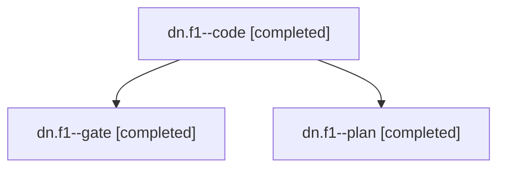

# Session: dn.f1

[Agent Hoods](../README.md) / [bbugyi200](../users/bbugyi200/README.md) / [apollo](../users/bbugyi200/machines/apollo/README.md) / [dn](../users/bbugyi200/machines/apollo/hoods/dn/README.md) / dn.f1

Owner: `bbugyi200.apollo` · Hood: `dn` · Members: 3

## Lineage

The diagram is an optional enhancement; the ordered table below contains the same lineage in accessible text.

| Role | Agent | State | Model / provider | Timing | Commits | Prompt | Chat |
|---|---|---|---|---|---:|---|---|
| code | dn.f1--code | completed | gpt-6-luna / codex | 2026-11-12T18:16:24.929490+00:00 → 2026-11-12T18:33:20.115157+00:00 | [1](../agents/bbugyi200.apollo.dn.f1--code/README.md#commits) | [Prompt](../agents/bbugyi200.apollo.dn.f1--code/prompt.md) | [Chat](../agents/bbugyi200.apollo.dn.f1--code/chat.md) |
| gate | dn.f1--gate | completed | claude-fable-5 / claude | 2026-11-12T18:14:33.550253+00:00 → 2026-11-12T18:15:50.133733+00:00 | 0 | — | [Chat](../agents/bbugyi200.apollo.dn.f1--gate/chat.md) |
| plan | dn.f1--plan | completed | claude-fable-5 / claude | 2026-11-12T18:02:47.549573+00:00 → 2026-11-12T18:13:39.106109+00:00 | 0 | [Prompt](../agents/bbugyi200.apollo.dn.f1--plan/prompt.md) | [Chat](../agents/bbugyi200.apollo.dn.f1--plan/chat.md) |

## Commits

| Role | Repo | Commit | Subject | Committed |
|---|---|---|---|---|
| code | bob-cli | [`d71a3bf`](https://github.com/bobs-org/bob-cli/commit/d71a3bf98f7971e056ec559bdad457184b48fcbd) | feat(gcal): sync the last N days | 2026-11-12 13:32:54 EST |

## Neighbors

| Agent | Relation | State |
|---|---|---|
| [dn](bbugyi200.apollo.dn.md) (session · 3) | ancestor | completed 3 |
| [dn.f0](bbugyi200.apollo.dn.f0.md) (session · 3) | dn hood | completed 3 |
