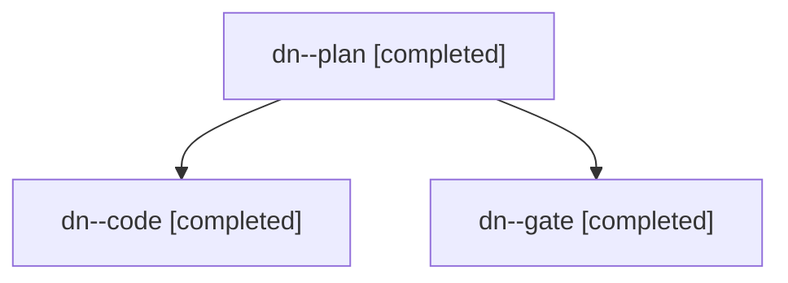

# Session: dn

[Agent Hoods](../README.md) / [bbugyi200](../users/bbugyi200/README.md) / [apollo](../users/bbugyi200/machines/apollo/README.md) / [dn](../users/bbugyi200/machines/apollo/hoods/dn/README.md) / dn

Owner: `bbugyi200.apollo` · Hood: `dn` · Members: 3

## Lineage

The diagram is an optional enhancement; the ordered table below contains the same lineage in accessible text.

| Role | Agent | State | Model / provider | Timing | Commits | Prompt | Chat |
|---|---|---|---|---|---:|---|---|
| plan | dn--plan | completed | claude-fable-5 / claude | 2026-11-12T15:31:51.723020+00:00 → 2026-11-12T15:40:51.497146+00:00 | 0 | [Prompt](../agents/bbugyi200.apollo.dn--plan/prompt.md) | [Chat](../agents/bbugyi200.apollo.dn--plan/chat.md) |
| code | dn--code | completed | gpt-6-luna / codex | 2026-11-12T15:55:37.284423+00:00 → 2026-11-12T16:46:00.197834+00:00 | [1](../agents/bbugyi200.apollo.dn--code/README.md#commits) | [Prompt](../agents/bbugyi200.apollo.dn--code/prompt.md) | [Chat](../agents/bbugyi200.apollo.dn--code/chat.md) |
| gate | dn--gate | completed | claude-fable-5 / claude | 2026-11-12T15:54:28.326141+00:00 → 2026-11-12T15:55:07.779330+00:00 | 0 | — | [Chat](../agents/bbugyi200.apollo.dn--gate/chat.md) |

## Commits

| Role | Repo | Commit | Subject | Committed |
|---|---|---|---|---|
| code | bob-cli | [`4ed4fda`](https://github.com/bobs-org/bob-cli/commit/4ed4fdabf33d065d516dcdfb8fe4785503f35726) | feat(gcal): support batched multi-day sync | 2026-11-12 11:45:36 EST |

## Neighbors

| Agent | Relation | State |
|---|---|---|
| [dn.f0](bbugyi200.apollo.dn.f0.md) (session · 3) | descendant | completed 3 |
| [dn.f1](bbugyi200.apollo.dn.f1.md) (session · 3) | descendant | completed 3 |
