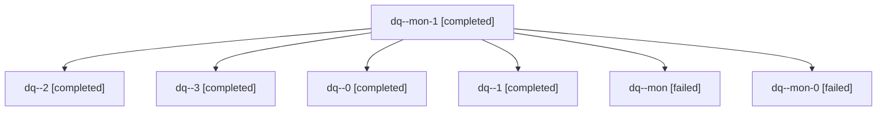

# Session: dq

[Agent Hoods](../README.md) / [bbugyi200](../users/bbugyi200/README.md) / [apollo](../users/bbugyi200/machines/apollo/README.md) / [dq](../users/bbugyi200/machines/apollo/hoods/dq/README.md) / dq

Owner: `bbugyi200.apollo` · Hood: `dq` · Members: 7

## Lineage



The diagram is an optional enhancement; the ordered table below contains the same lineage in accessible text.

| Role | Agent | State | Model / provider | Timing | Commits | Prompt | Chat |
|---|---|---|---|---|---:|---|---|
| <a id="member-mon-1"></a>mon-1 | dq--mon-1 | completed | gpt-6-astra / codex | 2026-11-12T21:43:32.094784+00:00 → 2026-11-12T22:46:17.549850+00:00 | 0 | — | [Chat](../agents/bbugyi200.apollo.dq--mon-1/chat.md) |
| <a id="member-2"></a>2 | dq--2 | completed | gpt-6-astra / codex | 2026-11-12T21:37:13.108824+00:00 → 2026-11-12T21:44:44.305820+00:00 | 0 | [Prompt](../agents/bbugyi200.apollo.dq--2/prompt.md) | [Chat](../agents/bbugyi200.apollo.dq--2/chat.md) |
| <a id="member-3"></a>3 | dq--3 | completed | gpt-6-astra / codex | 2026-11-12T22:46:51.798482+00:00 → 2026-11-12T23:00:23.695069+00:00 | 0 | [Prompt](../agents/bbugyi200.apollo.dq--3/prompt.md) | [Chat](../agents/bbugyi200.apollo.dq--3/chat.md) |
| <a id="member-0"></a>0 | dq--0 | completed | gpt-6-astra / codex | 2026-11-12T21:06:22.780781+00:00 → 2026-11-12T21:16:18.410776+00:00 | 0 | [Prompt](../agents/bbugyi200.apollo.dq--0/prompt.md) | [Chat](../agents/bbugyi200.apollo.dq--0/chat.md) |
| <a id="member-1"></a>1 | dq--1 | completed | gpt-6-astra / codex | 2026-11-12T21:20:24.628697+00:00 → 2026-11-12T21:29:52.469024+00:00 | 0 | [Prompt](../agents/bbugyi200.apollo.dq--1/prompt.md) | [Chat](../agents/bbugyi200.apollo.dq--1/chat.md) |
| <a id="member-mon"></a>mon | dq--mon | failed | gpt-6-astra / codex | 2026-11-12T21:15:23.457375+00:00 → 2026-11-12T21:19:53.315496+00:00 | 0 | — | [Chat](../agents/bbugyi200.apollo.dq--mon/chat.md) |
| <a id="member-mon-0"></a>mon-0 | dq--mon-0 | failed | gpt-6-astra / codex | 2026-11-12T21:28:50.652216+00:00 → 2026-11-12T21:36:51.682002+00:00 | 0 | — | [Chat](../agents/bbugyi200.apollo.dq--mon-0/chat.md) |

## Variables

| Role | Variable | Value |
|---|---|---|
| 3 | `artifacts` | \[{kind: file, label: Album header rollout verification, path: /home/bryan/.sase/artifacts/agents/gh\_bobs-org\_\_bob-cli/20261112174516/album-rollout-evidence-ee25120d7a1c.json, ref: file:explicit:1e158… |

#### artifacts

**Role:** `3`

```yaml
- kind: file
  label: Album header rollout verification
  path: /home/bryan/.sase/artifacts/agents/gh_bobs-org__bob-cli/20261112174516/album-rollout-evidence-ee25120d7a1c.json
  ref: file:explicit:1e158a38d48049a8df1636ba
  source_path: /tmp/album-rollout-evidence.json
```

Values are truncated for display; see each member's agent meta.json for the full values.
