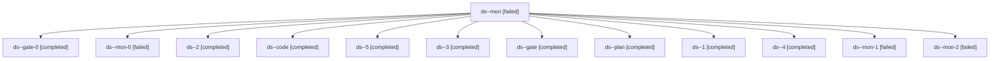

# Session: ds

[Agent Hoods](../README.md) / [bbugyi200](../users/bbugyi200/README.md) / [apollo](../users/bbugyi200/machines/apollo/README.md) / [ds](../users/bbugyi200/machines/apollo/hoods/ds/README.md) / ds

Owner: `bbugyi200.apollo` · Hood: `ds` · Members: 13

## Lineage



The diagram is an optional enhancement; the ordered table below contains the same lineage in accessible text.

| Role | Agent | State | Model / provider | Timing | Commits | Prompt | Chat |
|---|---|---|---|---|---:|---|---|
| <a id="member-mon"></a>mon | ds--mon | failed | gpt-6-luna / codex | 2026-11-13T16:07:33.676673+00:00 → 2026-11-13T17:45:52.406230+00:00 | 0 | — | [Chat](../agents/bbugyi200.apollo.ds--mon/chat.md) |
| <a id="member-gate-0"></a>gate-0 | ds--gate-0 | completed | gpt-6-luna / codex | 2026-11-13T15:56:59.775710+00:00 → 2026-11-13T15:57:53.889436+00:00 | 0 | — | [Chat](../agents/bbugyi200.apollo.ds--gate-0/chat.md) |
| <a id="member-mon-0"></a>mon-0 | ds--mon-0 | failed | gpt-6-luna / codex | 2026-11-13T17:57:36.238267+00:00 → 2026-11-13T18:00:57.499369+00:00 | 0 | — | [Chat](../agents/bbugyi200.apollo.ds--mon-0/chat.md) |
| <a id="member-2"></a>2 | ds--2 | completed | gpt-6-luna / codex | 2026-11-13T17:46:11.934476+00:00 → 2026-11-13T17:59:27.760724+00:00 | 0 | [Prompt](../agents/bbugyi200.apollo.ds--2/prompt.md) | [Chat](../agents/bbugyi200.apollo.ds--2/chat.md) |
| <a id="member-code"></a>code | ds--code | completed | gpt-6-luna / codex | 2026-11-13T12:57:51.953446+00:00 → 2026-11-13T15:57:26.563236+00:00 | 0 | [Prompt](../agents/bbugyi200.apollo.ds--code/prompt.md) | [Chat](../agents/bbugyi200.apollo.ds--code/chat.md) |
| <a id="member-5"></a>5 | ds--5 | completed | gpt-6-luna / codex | 2026-11-13T18:24:32.451053+00:00 → 2026-11-13T18:33:59.372907+00:00 | [1](../agents/bbugyi200.apollo.ds--5/README.md#commits) | [Prompt](../agents/bbugyi200.apollo.ds--5/prompt.md) | [Chat](../agents/bbugyi200.apollo.ds--5/chat.md) |
| <a id="member-3"></a>3 | ds--3 | completed | gpt-6-luna / codex | 2026-11-13T18:01:15.049494+00:00 → 2026-11-13T18:10:01.756061+00:00 | 0 | [Prompt](../agents/bbugyi200.apollo.ds--3/prompt.md) | [Chat](../agents/bbugyi200.apollo.ds--3/chat.md) |
| <a id="member-gate"></a>gate | ds--gate | completed | claude-fable-5 / claude | 2026-11-13T12:56:43.829817+00:00 → 2026-11-13T12:57:29.053948+00:00 | 0 | — | [Chat](../agents/bbugyi200.apollo.ds--gate/chat.md) |
| <a id="member-plan"></a>plan | ds--plan | completed | claude-fable-5 / claude | 2026-11-13T12:28:52.820765+00:00 → 2026-11-13T12:40:55.878925+00:00 | 0 | [Prompt](../agents/bbugyi200.apollo.ds--plan/prompt.md) | [Chat](../agents/bbugyi200.apollo.ds--plan/chat.md) |
| <a id="member-1"></a>1 | ds--1 | completed | gpt-6-luna / codex | 2026-11-13T15:59:10.599909+00:00 → 2026-11-13T16:09:25.529543+00:00 | 0 | [Prompt](../agents/bbugyi200.apollo.ds--1/prompt.md) | [Chat](../agents/bbugyi200.apollo.ds--1/chat.md) |
| <a id="member-4"></a>4 | ds--4 | completed | gpt-6-luna / codex | 2026-11-13T18:11:59.544978+00:00 → 2026-11-13T18:22:44.726115+00:00 | 0 | [Prompt](../agents/bbugyi200.apollo.ds--4/prompt.md) | [Chat](../agents/bbugyi200.apollo.ds--4/chat.md) |
| <a id="member-mon-1"></a>mon-1 | ds--mon-1 | failed | gpt-6-luna / codex | 2026-11-13T18:07:46.716685+00:00 → 2026-11-13T18:11:31.668427+00:00 | 0 | — | [Chat](../agents/bbugyi200.apollo.ds--mon-1/chat.md) |
| <a id="member-mon-2"></a>mon-2 | ds--mon-2 | failed | gpt-6-luna / codex | 2026-11-13T18:20:30.848936+00:00 → 2026-11-13T18:24:14.348432+00:00 | 0 | — | [Chat](../agents/bbugyi200.apollo.ds--mon-2/chat.md) |

## Commits

| Role | Repo | Commit | Subject | Committed |
|---|---|---|---|---|
| 5 | bob-cli | [`93a8baf`](https://github.com/bobs-org/bob-cli/commit/93a8baf435277fcbffa40f32fba43b399e3f9493) | chore(album): preserve acceptance evidence snapshots | 2026-11-13 13:32:52 EST |

## Variables

| Role | Variable | Value |
|---|---|---|
| code | `artifacts` | \[{bead: bob-cli-kr.4.1, kind: file, label: Album Schema Card 85-check Athena acceptance report, path: /home/bryan/.sase/artifacts/agents/gh\_bobs-org\_\_bob-cli/20261113075728/album-schema-apply-11daf3f… |

#### artifacts

**Role:** `code`

```yaml
- bead: bob-cli-kr.4.1
  kind: file
  label: Album Schema Card 85-check Athena acceptance report
  path: /home/bryan/.sase/artifacts/agents/gh_bobs-org__bob-cli/20261113075728/album-schema-apply-11daf3f895f0.json
  ref: file:explicit:ccb2587cde62473912a636dd
  source_path: /home/bryan/.local/state/sase/workspaces/bobs-org/bob-cli/bob-cli_10/evidence/album-schema-finish-apply/album-schema-apply.json
- bead: bob-cli-kr.4.1
  kind: file
  label: Eleven visually reviewed album acceptance screenshots and checksums
  path: /home/bryan/.sase/artifacts/agents/gh_bobs-org__bob-cli/20261113075728/reviewed-screenshots.tar-07cee2d3870e.gz
  ref: file:explicit:4868023270d56502fab1e6ad
  source_path: /home/bryan/.local/state/sase/workspaces/bobs-org/bob-cli/bob-cli_10/evidence/album-schema-finish-apply/reviewed-screenshots.tar.gz
- bead: bob-cli-kr.4.1
  kind: markdown
  label: Athena acceptance, startup smoke, and guarded deploy provenance
  path: /home/bryan/.sase/artifacts/agents/gh_bobs-org__bob-cli/20261113075728/provenance-e90d5f4c22e2.md
  ref: file:explicit:3d3176278cad3de483dcd62c
  source_path: /home/bryan/.local/state/sase/workspaces/bobs-org/bob-cli/bob-cli_10/evidence/album-schema-finish-apply/provenance.md
- bead: bob-cli-kr.4.1
  kind: file
  label: Athena isolated Obsidian startup smoke report
  path: /home/bryan/.sase/artifacts/agents/gh_bobs-org__bob-cli/20261113075728/obsidian-startup-smoke-606b4d296a80.json
  ref: file:explicit:27d391dfb57f7c0347ce1d55
  source_path: /home/bryan/.local/state/sase/workspaces/bobs-org/bob-cli/bob-cli_10/evidence/album-schema-finish-apply/obsidian-startup-smoke.json
- bead: bob-cli-kr.4.1
  kind: file
  label: Guarded deploy preflight: 11-row state, managed hashes, and refusal
  path: /home/bryan/.sase/artifacts/agents/gh_bobs-org__bob-cli/20261113075728/deploy-preflight-audit.tar-6b8959fe3e65.gz
  ref: file:explicit:f4071040a46f3ac9fedd5cc1
  source_path: /home/bryan/.local/state/sase/workspaces/bobs-org/bob-cli/bob-cli_10/evidence/album-schema-finish-apply/deploy-preflight-audit.tar.gz
- bead: bob-cli-kr.4.1
  kind: file
  label: Album Schema Card final Athena acceptance and gate evidence
  path: /home/bryan/.sase/artifacts/agents/gh_bobs-org__bob-cli/20261113075728/album-schema-finish-apply-final.tar-072cee4499f0.gz
  ref: file:explicit:dfea45fdd93356b45d6a23e4
  source_path: /home/bryan/.local/state/sase/workspaces/bobs-org/bob-cli/bob-cli_10/evidence/album-schema-finish-apply-final.tar.gz
```

Values are truncated for display; see each member's agent meta.json for the full values.
