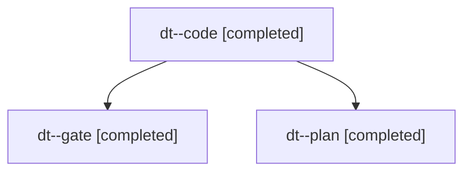

# Session: dt

[Agent Hoods](../README.md) / [bbugyi200](../users/bbugyi200/README.md) / [apollo](../users/bbugyi200/machines/apollo/README.md) / [dt](../users/bbugyi200/machines/apollo/hoods/dt/README.md) / dt

Owner: `bbugyi200.apollo` · Hood: `dt` · Members: 3

## Lineage

The diagram is an optional enhancement; the ordered table below contains the same lineage in accessible text.

| Role | Agent | State | Model / provider | Timing | Commits | Prompt | Chat |
|---|---|---|---|---|---:|---|---|
| code | dt--code | completed | grok-4.6 / grok | 2026-11-13T15:34:14.825173+00:00 → 2026-11-13T16:22:45.331114+00:00 | 0 | [Prompt](../agents/bbugyi200.apollo.dt--code/prompt.md) | [Chat](../agents/bbugyi200.apollo.dt--code/chat.md) |
| gate | dt--gate | completed | opus / claude | 2026-11-13T15:32:51.153534+00:00 → 2026-11-13T15:33:39.559708+00:00 | 0 | — | [Chat](../agents/bbugyi200.apollo.dt--gate/chat.md) |
| plan | dt--plan | completed | opus / claude | 2026-11-13T15:18:15.431398+00:00 → 2026-11-13T15:31:53.955061+00:00 | 0 | [Prompt](../agents/bbugyi200.apollo.dt--plan/prompt.md) | [Chat](../agents/bbugyi200.apollo.dt--plan/chat.md) |
