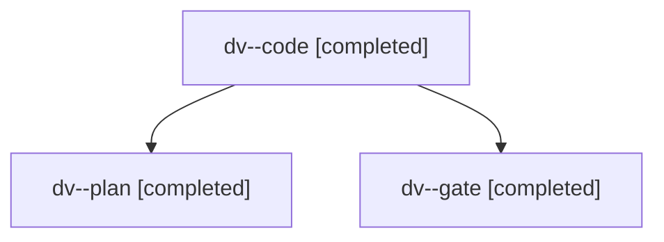

# Session: dv

[Agent Hoods](../README.md) / [bbugyi200](../users/bbugyi200/README.md) / [apollo](../users/bbugyi200/machines/apollo/README.md) / [dv](../users/bbugyi200/machines/apollo/hoods/dv/README.md) / dv

Owner: `bbugyi200.apollo` · Hood: `dv` · Members: 3

## Lineage

The diagram is an optional enhancement; the ordered table below contains the same lineage in accessible text.

| Role | Agent | State | Model / provider | Timing | Commits | Prompt | Chat |
|---|---|---|---|---|---:|---|---|
| code | dv--code | completed | grok-4.6 / grok | 2026-11-13T15:32:59.854061+00:00 → 2026-11-13T15:42:55.814697+00:00 | 0 | [Prompt](../agents/bbugyi200.apollo.dv--code/prompt.md) | [Chat](../agents/bbugyi200.apollo.dv--code/chat.md) |
| plan | dv--plan | completed | opus / claude | 2026-11-13T15:25:23.379145+00:00 → 2026-11-13T15:30:11.496866+00:00 | 0 | [Prompt](../agents/bbugyi200.apollo.dv--plan/prompt.md) | [Chat](../agents/bbugyi200.apollo.dv--plan/chat.md) |
| gate | dv--gate | completed | opus / claude | 2026-11-13T15:31:24.175944+00:00 → 2026-11-13T15:32:28.844988+00:00 | 0 | — | [Chat](../agents/bbugyi200.apollo.dv--gate/chat.md) |
