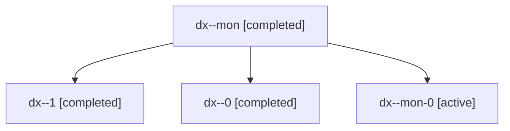

# Session: dx

[Agent Hoods](../README.md) / [bbugyi200](../users/bbugyi200/README.md) / [apollo](../users/bbugyi200/machines/apollo/README.md) / [dx](../users/bbugyi200/machines/apollo/hoods/dx/README.md) / dx

Owner: `bbugyi200.apollo` · Hood: `dx` · Members: 4

## Lineage

The diagram is an optional enhancement; the ordered table below contains the same lineage in accessible text.

| Role | Agent | State | Model / provider | Timing | Commits | Prompt | Chat |
|---|---|---|---|---|---:|---|---|
| mon | dx--mon | completed | gpt-6-astra / codex | 2026-11-14T12:33:32.926143+00:00 → 2026-11-14T13:11:36.285465+00:00 | 0 | — | [Chat](../agents/bbugyi200.apollo.dx--mon/chat.md) |
| 1 | dx--1 | completed | gpt-6-astra / codex | 2026-11-14T13:14:59.449926+00:00 → 2026-11-14T13:23:16.116560+00:00 | 0 | [Prompt](../agents/bbugyi200.apollo.dx--1/prompt.md) | [Chat](../agents/bbugyi200.apollo.dx--1/chat.md) |
| 0 | dx--0 | completed | gpt-6-astra / codex | 2026-11-14T12:26:05.894357+00:00 → 2026-11-14T12:35:24.334345+00:00 | 0 | [Prompt](../agents/bbugyi200.apollo.dx--0/prompt.md) | [Chat](../agents/bbugyi200.apollo.dx--0/chat.md) |
| mon-0 | dx--mon-0 | active | gpt-6-astra / codex | 2026-11-14T13:18:15.971649+00:00 | 0 | — | — |
