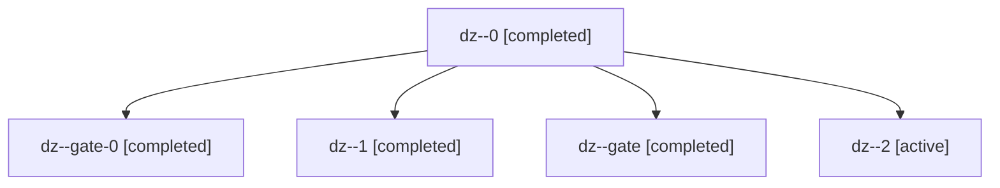

# Session: dz

[Agent Hoods](../README.md) / [bbugyi200](../users/bbugyi200/README.md) / [apollo](../users/bbugyi200/machines/apollo/README.md) / [dz](../users/bbugyi200/machines/apollo/hoods/dz/README.md) / dz

Owner: `bbugyi200.apollo` · Hood: `dz` · Members: 5

## Lineage

The diagram is an optional enhancement; the ordered table below contains the same lineage in accessible text.

| Role | Agent | State | Model / provider | Timing | Commits | Prompt | Chat |
|---|---|---|---|---|---:|---|---|
| 0 | dz--0 | completed | opus / claude | 2026-11-14T12:59:55.562699+00:00 → 2026-11-14T14:39:43.858548+00:00 | [1](../agents/bbugyi200.apollo.dz--0/README.md#commits) | [Prompt](../agents/bbugyi200.apollo.dz--0/prompt.md) | [Chat](../agents/bbugyi200.apollo.dz--0/chat.md) |
| gate-0 | dz--gate-0 | completed | opus / claude | 2026-11-14T14:54:35.265474+00:00 → 2026-11-14T14:55:50.092618+00:00 | 0 | — | [Chat](../agents/bbugyi200.apollo.dz--gate-0/chat.md) |
| 1 | dz--1 | completed | opus / claude | 2026-11-14T14:43:07.867307+00:00 → 2026-11-14T14:53:26.677409+00:00 | 0 | [Prompt](../agents/bbugyi200.apollo.dz--1/prompt.md) | [Chat](../agents/bbugyi200.apollo.dz--1/chat.md) |
| gate | dz--gate | completed | opus / claude | 2026-11-14T14:41:04.354495+00:00 → 2026-11-14T14:41:30.235293+00:00 | 0 | — | [Chat](../agents/bbugyi200.apollo.dz--gate/chat.md) |
| 2 | dz--2 | active | opus / claude | 20261114095548 | 0 | [Prompt](../agents/bbugyi200.apollo.dz--2/prompt.md) | — |

## Commits

| Role | Repo | Commit | Subject | Committed |
|---|---|---|---|---|
| 0 | bob-cli | [`11abff0`](https://github.com/bobs-org/bob-cli/commit/11abff0b65b92959c3906df5661597e2530142be) | fix(ci): clear four release-train blockers on master | 2026-11-14 09:38:31 EST |
