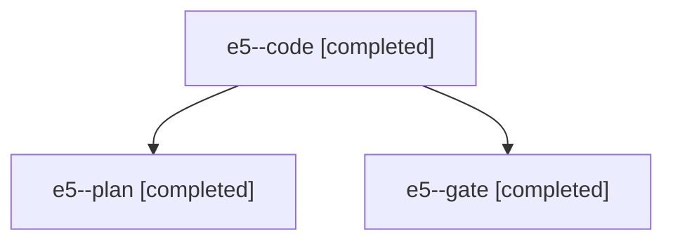

# Session: e5

[Agent Hoods](../README.md) / [bbugyi200](../users/bbugyi200/README.md) / [apollo](../users/bbugyi200/machines/apollo/README.md) / [e5](../users/bbugyi200/machines/apollo/hoods/e5/README.md) / e5

Owner: `bbugyi200.apollo` · Hood: `e5` · Members: 3

## Lineage

The diagram is an optional enhancement; the ordered table below contains the same lineage in accessible text.

| Role | Agent | State | Model / provider | Timing | Commits | Prompt | Chat |
|---|---|---|---|---|---:|---|---|
| code | e5--code | completed | gpt-6-luna / codex | 2026-11-15T12:16:20.639135+00:00 → 2026-11-15T13:08:46.858838+00:00 | [1](../agents/bbugyi200.apollo.e5--code/README.md#commits) | [Prompt](../agents/bbugyi200.apollo.e5--code/prompt.md) | [Chat](../agents/bbugyi200.apollo.e5--code/chat.md) |
| plan | e5--plan | completed | opus / claude | 2026-11-15T11:55:57.662360+00:00 → 2026-11-15T12:11:43.291540+00:00 | 0 | [Prompt](../agents/bbugyi200.apollo.e5--plan/prompt.md) | [Chat](../agents/bbugyi200.apollo.e5--plan/chat.md) |
| gate | e5--gate | completed | opus / claude | 2026-11-15T12:14:58.953440+00:00 → 2026-11-15T12:15:46.173676+00:00 | 0 | — | [Chat](../agents/bbugyi200.apollo.e5--gate/chat.md) |

## Commits

| Role | Repo | Commit | Subject | Committed |
|---|---|---|---|---|
| code | bob-cli | [`9c2c240`](https://github.com/bobs-org/bob-cli/commit/9c2c240480998e1b9ecd82a5c70aefbe963b8c58) | feat(gcal)!: root Event Tasks at meet\_inbox by default | 2026-11-15 08:07:35 EST |
