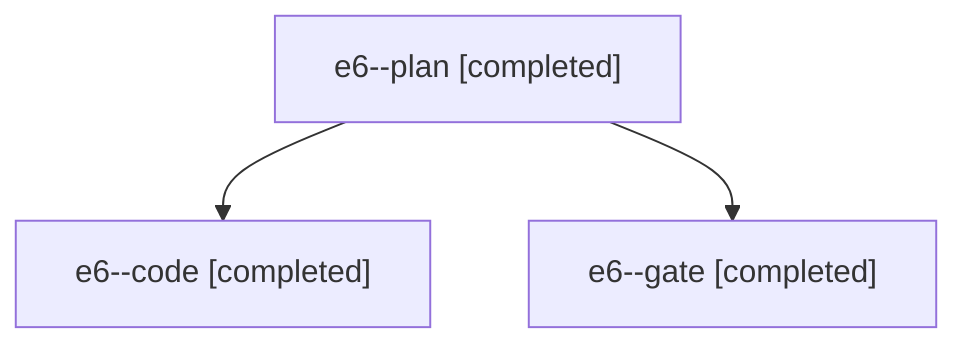

# Session: e6

[Agent Hoods](../README.md) / [bbugyi200](../users/bbugyi200/README.md) / [apollo](../users/bbugyi200/machines/apollo/README.md) / [e6](../users/bbugyi200/machines/apollo/hoods/e6/README.md) / e6

Owner: `bbugyi200.apollo` · Hood: `e6` · Members: 3

## Lineage

The diagram is an optional enhancement; the ordered table below contains the same lineage in accessible text.

| Role | Agent | State | Model / provider | Timing | Commits | Prompt | Chat |
|---|---|---|---|---|---:|---|---|
| plan | e6--plan | completed | opus / claude | 2026-11-15T11:57:55.132560+00:00 → 2026-11-15T12:08:37.863177+00:00 | 0 | [Prompt](../agents/bbugyi200.apollo.e6--plan/prompt.md) | [Chat](../agents/bbugyi200.apollo.e6--plan/chat.md) |
| code | e6--code | completed | muse-spark-1.3-contributor / muse | 2026-11-15T12:15:01.704151+00:00 → 2026-11-15T12:43:57.975125+00:00 | 0 | [Prompt](../agents/bbugyi200.apollo.e6--code/prompt.md) | [Chat](../agents/bbugyi200.apollo.e6--code/chat.md) |
| gate | e6--gate | completed | opus / claude | 2026-11-15T12:13:25.933828+00:00 → 2026-11-15T12:14:26.142684+00:00 | 0 | — | [Chat](../agents/bbugyi200.apollo.e6--gate/chat.md) |
