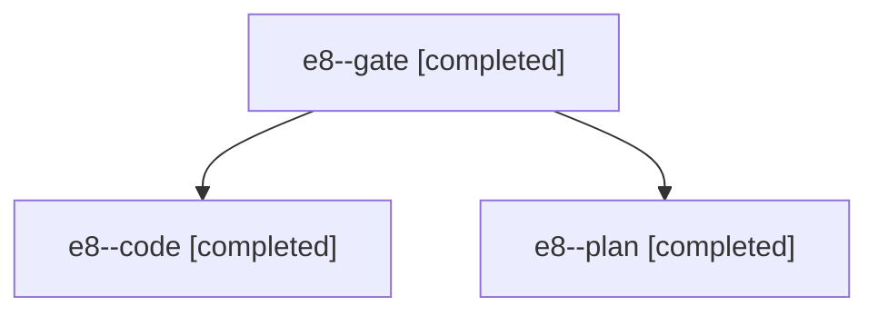

# Session: e8

[Agent Hoods](../README.md) / [bbugyi200](../users/bbugyi200/README.md) / [apollo](../users/bbugyi200/machines/apollo/README.md) / [e8](../users/bbugyi200/machines/apollo/hoods/e8/README.md) / e8

Owner: `bbugyi200.apollo` · Hood: `e8` · Members: 3

## Lineage

The diagram is an optional enhancement; the ordered table below contains the same lineage in accessible text.

| Role | Agent | State | Model / provider | Timing | Commits | Prompt | Chat |
|---|---|---|---|---|---:|---|---|
| gate | e8--gate | completed | opus / claude | 2026-11-15T18:28:08.324173+00:00 → 2026-11-15T18:29:17.876611+00:00 | 0 | — | [Chat](../agents/bbugyi200.apollo.e8--gate/chat.md) |
| code | e8--code | completed | muse-spark-1.3-contributor / muse | 2026-11-15T18:29:53.907384+00:00 → 2026-11-15T19:16:30.432626+00:00 | [1](../agents/bbugyi200.apollo.e8--code/README.md#commits) | [Prompt](../agents/bbugyi200.apollo.e8--code/prompt.md) | [Chat](../agents/bbugyi200.apollo.e8--code/chat.md) |
| plan | e8--plan | completed | opus / claude | 2026-11-15T18:10:40.372069+00:00 → 2026-11-15T18:26:19.683385+00:00 | 0 | [Prompt](../agents/bbugyi200.apollo.e8--plan/prompt.md) | [Chat](../agents/bbugyi200.apollo.e8--plan/chat.md) |

## Commits

| Role | Repo | Commit | Subject | Committed |
|---|---|---|---|---|
| code | bob-cli | [`90e5247`](https://github.com/bobs-org/bob-cli/commit/90e5247eaa08a05b0f44ccbba062360f03f23ac1) | test(gcal): make ack termios tests portable to macOS | 2026-11-15 14:15:58 EST |
